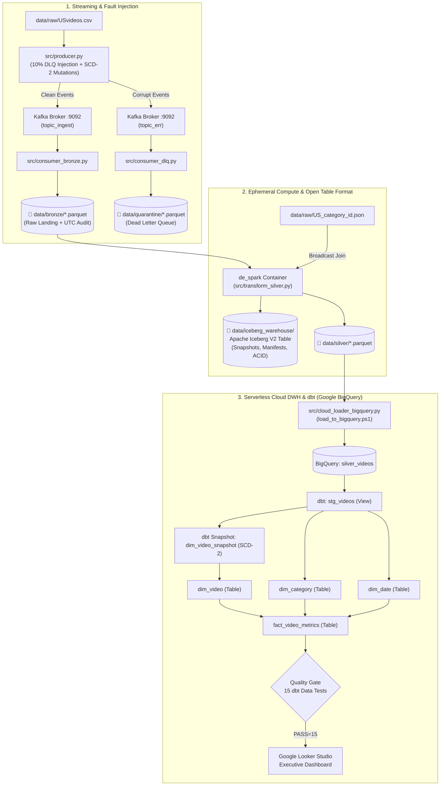
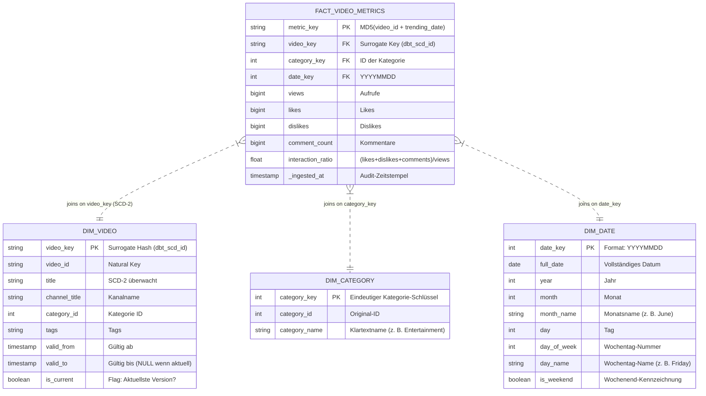

# YouTube DataOps & Analytics Platform (2026 Edition)

[-231F20?logo=apachekafka)](https://kafka.apache.org/)
[](https://spark.apache.org/)
[](https://iceberg.apache.org/)
[](https://www.getdbt.com/)
[](https://cloud.google.com/bigquery)
[](https://airflow.apache.org/)
[](https://prometheus.io/)
[](https://grafana.com/)
[](https://www.docker.com/)

An enterprise-grade, containerized **End-to-End DataOps & Analytics Platform** built around the YouTube Trending Videos dataset. 

This repository documents the evolution of an on-premises 2021 Big Data Capstone into a modern, production-grade **Medallion Lakehouse** combining **Apache Kafka**, **Ephemeral PySpark**, **Apache Iceberg V2**, **dbt Core**, **Google BigQuery**, and **Apache Airflow**.

---

## 📦 Version History: v1.0.0 vs. Modern Evolution

```
v1.0.0 (Core Foundation)             Modern Evolution (Kimball DWH & Lakehouse)
┌───────────────────────────────┐     ┌────────────────────────────────────────────────────────┐
│ • Kafka KRaft (Zero-ZooKeeper)│     │ • Apache Iceberg V2 Table Format (ACID & Snapshots)    │
│ • Dead Letter Queue (DLQ)     │ ──► │ • Streaming Metadata Evolution & SCD-2 Simulation     │
│ • Ephemeral Docker PySpark    │     │ • Kimball Star-Schema via dbt Core (Facts & Dimensions)│
│ • Airflow 2.9 & Monitoring    │     │ • In-Warehouse Data Quality Gates (15 Automated Tests) │
│ • Parquet Bulk BigQuery Sync  │     │ • Zero-Idle Serverless Cloud Ready Architecture        │
└───────────────────────────────┘     └────────────────────────────────────────────────────────┘
```

### 🔹 Was war Release `v1.0.0`? (Eingefrorenes Fundament)
Der Release [`v1.0.0`](https://github.com/BHW80/DE_Capstone_2026/releases/tag/v1.0.0) löste die historischen Schmerzen des 2021/2022er Windows-Bare-Metal-Setups (Hadoop/Winutils/Batch-Skripte):
* **Containerisierte Ingestion:** Apache Kafka im KRaft-Modus (ohne ZooKeeper) via Docker Compose.
* **Resiliente Streaming-Pipeline:** Producer mit 10 % Fault-Injection und automatischer Umleitung korrupter Datensätze in eine **Dead Letter Queue (DLQ)** (`data/quarantine/*.parquet`).
* **Ephemerer Spark-Compute:** PySpark läuft in einem On-Demand-Container über den Docker-Socket (`/var/run/docker.sock`) mit nativer Catalyst-Engine und Zero-Shuffle Broadcast-Joins.
* **Observability:** Prometheus & Grafana Stack mit automatischem Datasource-Provisioning.
* **Cloud-Export:** Basis-Laden aggregierter Gold-Parquet-Marts nach Google BigQuery.

---

### 🔹 Die Weiterentwicklung (Kimball DWH & Open Table Formats)

Die Weiterentwicklung hebt die Plattform vom reinen File-basierten Lakehouse auf das Niveau eines **unternehmensweiten Cloud Data Warehouse**:

#### 1. Open Table Format: Apache Iceberg V2
* **Das Problem bei reinem Parquet:** Lose Parquet-Dateien im Ordner bieten keine Transaktionssicherheit (ACID). Bricht ein Job ab, bleiben korrumpierte Dateifragmente zurück. Zudem existiert keine Historie.
* **Die Iceberg-Lösung:** Iceberg trennt physische Daten und logische Metadaten.
  * In `data/iceberg_warehouse/silver/videos/metadata/` wird jeder Commit als unveränderlicher Snapshot in einer `v1.metadata.json` und Avro-Manifest-Listen festgehalten.
  * **Vorteil:** Garantierte atomare Schreibvorgänge, Data Skipping (Min/Max-Statistiken pro Datei) und vollständiger **Time-Travel** (`table.history()`).

#### 2. Streaming Metadata Evolution & SCD-2 (Slowly Changing Dimensions Typ 2)
* **Das Problem in der Praxis:** YouTuber ändern häufig nach 12–24 Stunden Titel, Thumbnails oder Tags, um die Klickrate (CTR) zu optimieren. In einfachen Datenbanken (SCD-1) wird der alte Titel überschrieben – die Information, mit welchem Titel ein Video viral ging, geht für immer verloren.
* **Die Lösung:** Der Streaming Producer ([`src/producer.py`](src/producer.py)) simuliert bei aufeinanderfolgenden Trend-Tagen kontrollierte Titel-Mutationen. dbt erfasst diese Historie über Snapshots:
  * Alte Version: Erhält ein Gültigkeitsende (`dbt_valid_to = TIMESTAMP`).
  * Neue Version: Wird als aktuell markiert (`dbt_valid_to = NULL`, `is_current = TRUE`).

#### 3. Kimball Star-Schema mit dbt Core
Transformationen werden nach dem modernen **ELT-Prinzip** direkt in Google BigQuery mit dbt ausgeführt:
* **`dim_video`:** Konsumierbare SCD-2 Dimension mit eindeutigem Surrogate Key (`video_key`).
* **`dim_category`:** Conformed Dimension zur Normalisierung der Videogenres.
* **`dim_date`:** Vorberechnete Datumsdimension (`date_key`, Wochentag, Monat, `is_weekend`).
* **`fact_video_metrics`:** Tägliche Interaktionsmetriken (`views`, `likes`, `dislikes`, `interaction_ratio`), verknüpft mit den Surrogate Keys der Dimensionen über Point-in-Time Joins.

#### 4. Automatisierte Quality Gates
Vor der Freigabe für BI-Dashboards laufen **15 automatisierte dbt-Tests**:
* **Primärschlüssel-Integrität:** `unique` und `not_null` auf allen Dimensionen und Fakten.
* **Referenzielle Integrität (`relationships`):** Verhindert *Orphan Records* – jeder Fremdschlüssel in der Faktentabelle muss nachweislich in der verknüpften Dimension existieren.

---

## 🏛️ Architektur-Vergleich: 2021 vs. 2026 v1.0.0 vs. Modern Evolution

| Dimension | 2021 Legacy (Purdue/Simplilearn) | 2026 Release v1.0.0 | Modern Evolution (Aktuell) |
| :--- | :--- | :--- | :--- |
| **Plattform** | Windows 10 Bare-Metal + Batch | Docker Desktop + Local Host | Docker Compose + Google Cloud Platform |
| **Streaming** | Kafka + ZooKeeper (Batch-Timeouts) | Kafka KRaft + Dead Letter Queue | Kafka KRaft mit SCD-2 Event-Mutationen |
| **Storage Format** | Unkomprimierte CSVs via Flume | Snappy Parquet (Medallion) | **Apache Iceberg V2** (Silver) + Parquet |
| **DWH Modeling** | Flache CSVs / NoSQL Cosmos DB | Flache Gold Parquet Dateien | **Kimball Star-Schema** (Fakten & Dimensionen) |
| **Historisierung** | Keine (SCD-1 Überschreiben) | Keine | **SCD-2 via dbt Snapshots** in BigQuery |
| **Transformation** | Databricks (Langsame Python UDFs) | Ephemeral Spark (Native Catalyst) | Spark (Iceberg Cleanse) + **dbt Core (ELT)** |
| **Quality Gates** | Keine (Blindes Vertrauen) | Einfacher Airflow Threshold Check | **15 automatische dbt Schema- & Data-Tests** |
| **Serving & BI** | Power BI Desktop (.pbix) | BigQuery Bulk Parquet Sync | BigQuery Star-Schema & Looker Studio |

---

## 📐 Systemarchitektur (End-to-End)



---

## 🏛️ Das Kimball DWH Star-Schema im Detail



---

## 🚀 Quickstart Guide (Schritt für Schritt zum Nachvollziehen)

### Voraussetzungen
* Windows 10/11 mit PowerShell
* Docker Desktop installiert und gestartet
* Python 3.10+
* Google Cloud Platform (GCP) Service Account mit BigQuery-Berechtigungen (gespeichert als `gcp_service_account.json` im Root-Verzeichnis)

---

### Schritt 1: Python-Umgebung einrichten
```powershell
cd D:\Projekte\CloudEng\DE_Capstone_2026

# Virtual Environment erstellen & aktivieren
python -m venv .venv
Set-ExecutionPolicy -Scope Process -ExecutionPolicy Bypass
.\.venv\Scripts\Activate.ps1

# Abhängigkeiten installieren (inklusive dbt-bigquery & PySpark)
pip install -r requirements.txt
```

---

### Schritt 2: Kafka Streaming starten & Daten einspeisen
```powershell
# 1. Kafka Broker & Kafka-UI im Hintergrund starten
docker compose -f docker/docker-compose-kafka.yml up -d

# 2. Producer starten (erzeugt Events, DLQ-Fehler und SCD-2 Mutationen)
python src/producer.py

# 3. Consumers ausführen (Bronze Ingest & Dead Letter Queue)
python src/consumer_bronze.py
python src/consumer_dlq.py
```
* **Kafka-UI:** [http://localhost:8080](http://localhost:8080)

---

### Schritt 3: Silver-Transformation mit Apache Iceberg ausführen
```powershell
.\run_silver.ps1
```
* Startet einen ephemeren Spark-Container mit dem Iceberg-JAR (`iceberg-spark-runtime-3.5`).
* Erzeugt die **Apache Iceberg V2 Tabelle** unter [`data/iceberg_warehouse/silver/videos/`](data/iceberg_warehouse/silver/videos/).
* Gibt die Snapshot-Historie im Terminal aus.

---

### Schritt 4: Daten nach Google BigQuery übertragen
```powershell
.\load_to_bigquery.ps1
```
* Lädt die bereinigten Silver-Events als Quelltabelle `silver_videos` in dein BigQuery-Dataset `youtube_analytics`.

---

### Schritt 5: dbt Star-Schema, SCD-2 & Quality Gate ausführen
Für dbt steht das universelle Runner-Skript [`run_dbt.ps1`](run_dbt.ps1) bereit:

```powershell
# 1. Verbindung zu BigQuery testen
.\run_dbt.ps1 debug

# 2. SCD-2 Snapshot aktualisieren (erfasst Titel- & Metadatenänderungen)
.\run_dbt.ps1 snapshot

# 3. Star-Schema Modelle in BigQuery materialisieren (dim_video, dim_category, dim_date, fact_video_metrics)
.\run_dbt.ps1 run

# 4. Quality Gate ausführen (15 automatisierte Prüfungen)
.\run_dbt.ps1 test
```

---

## 📂 Repository Layout

```
DE_Capstone_2026/
├── dags/                                 # Apache Airflow DAG Definitionen
│   ├── de_capstone_pipeline.py           # Lokale Medallion-Pipeline (Bronze -> Silver -> Gold -> Gate)
│   └── de_cloud_release_pipeline.py      # Automatisierter BigQuery-Release-DAG
├── dbt/                                  # dbt Core Projekt (Kimball DWH & SCD-2)
│   ├── dbt_project.yml                   # dbt Projektkonfiguration
│   ├── profiles.yml                      # BigQuery Profil (Verbindung via gcp_service_account.json)
│   ├── snapshots/                        # ⭐ SCD-2 Snapshot Definitionen
│   │   └── dim_video_snapshot.sql        # Überwacht Titel-, Kanal- und Kategorieänderungen
│   └── models/
│       ├── staging/
│       │   ├── sources.yml               # Deklaration der BigQuery-Quelltabellen
│       │   └── stg_videos.sql            # Typisierung & Bereinigungs-View
│       └── marts/core/                   # ⭐ Kimball Star-Schema Marts
│           ├── dim_video.sql             # SCD-2 Dimension mit is_current Flag
│           ├── dim_category.sql          # Conformed Kategorie-Dimension
│           ├── dim_date.sql              # Kalender- & Datumsdimension
│           ├── fact_video_metrics.sql    # Faktentabelle mit täglichen Interaktionsmetriken
│           └── schema.yml                # ⭐ Quality Gate (15 automatisierte Integritätstests)
├── docker/                               # Modulare Docker Compose Konfigurationen
│   ├── docker-compose-kafka.yml          # Apache Kafka KRaft & Kafka-UI
│   ├── docker-compose-spark.yml          # Ephemerer PySpark Compute Container
│   ├── docker-compose-airflow.yml        # Airflow Standalone & PostgreSQL
│   ├── docker-compose-monitoring.yml     # Prometheus & Grafana Stack
│   ├── prometheus.yml                    # Prometheus Scrape-Konfiguration
│   └── grafana_datasources.yml           # Grafana Datasource Auto-Provisioning
├── src/                                  # Python & PySpark Quellcode
│   ├── producer.py                       # Streaming-Producer (Fault Injection + SCD-2 Mutation)
│   ├── consumer_bronze.py                # Bronze Ingestion Consumer
│   ├── consumer_dlq.py                   # Dead Letter Queue Consumer (Quarantäne)
│   ├── transform_silver.py               # PySpark Silver-Transformation mit Apache Iceberg V2
│   ├── transform_gold.py                 # PySpark Gold Aggregationen & Window Functions
│   └── cloud_loader_bigquery.py          # BigQuery Idempotenter Parquet & Silver Uploader
├── run_bronze.ps1                        # Runner: Bronze Kafka Ingestion
├── run_silver.ps1                        # Runner: PySpark Apache Iceberg Job
├── run_gold.ps1                          # Runner: PySpark Gold Aggregation
├── run_dbt.ps1                           # Runner: dbt CLI Steuerung (debug, run, snapshot, test)
├── load_to_bigquery.ps1                  # Runner: Google BigQuery Cloud Release
├── start_airflow.ps1                     # Runner: Start Airflow & PostgreSQL
├── stop_airflow.ps1                      # Runner: Stopp Airflow
├── start_monitoring.ps1                  # Runner: Start Prometheus & Grafana
├── stop_monitoring.ps1                   # Runner: Stopp Prometheus & Grafana
├── requirements.txt                      # Python-Bibliotheken (inkl. dbt-bigquery, PySpark, PyArrow)
└── README.md                             # Vollständige Projektdokumentation
```

---

## 📜 Lizenz & Danksagung
* **Datensatz:** YouTube Trending Video Dataset (Kaggle).
* **Ausgangspunkt:** Modernisiert aus dem 2021/2022 Post Graduate Program in Data Engineering (Purdue University / Simplilearn).
* **Autor:** Bernd Weltler
