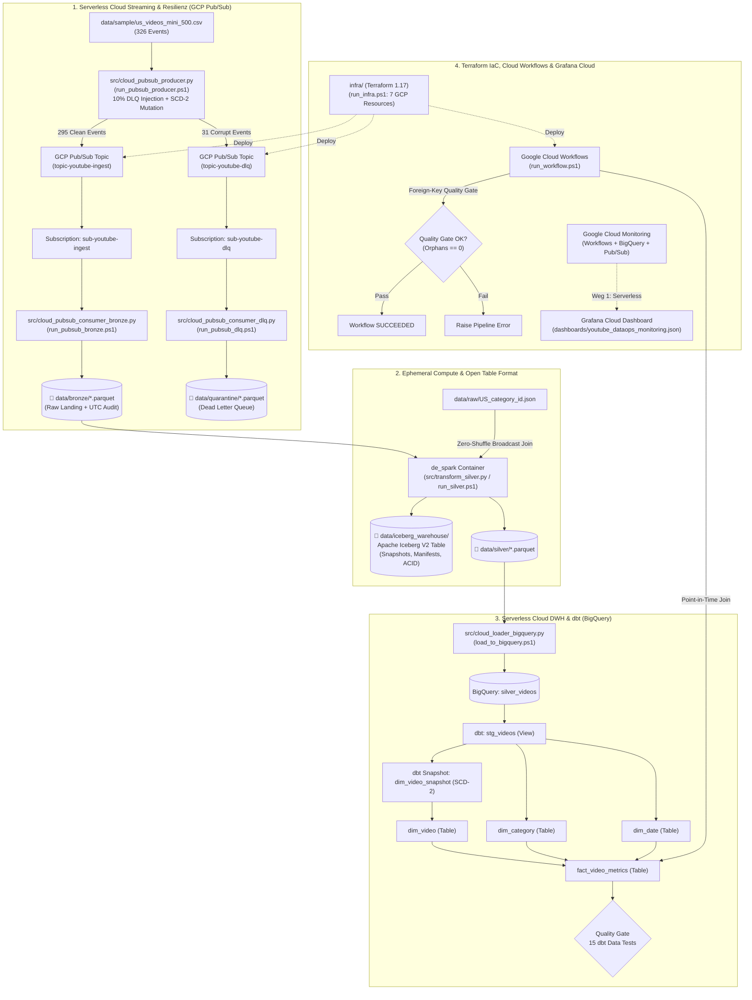
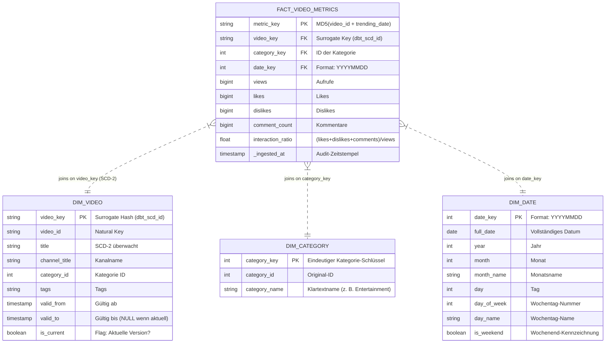

# YouTube DataOps & Analytics Platform (2026 Edition)

[](https://cloud.google.com/pubsub)
[-Apache%20Kafka%20(KRaft)-231F20?logo=apachekafka)](https://kafka.apache.org/)
[](https://spark.apache.org/)
[](https://iceberg.apache.org/)
[](https://www.getdbt.com/)
[](https://cloud.google.com/bigquery)
[](https://cloud.google.com/workflows)
[](https://grafana.com/)
[](https://www.terraform.io/)
[](https://github.com/features/actions)

Eine unternehmensweite, produktionsreife **End-to-End DataOps & Analytics Plattform** auf Basis des Kaggle YouTube Trending Video Datensatzes.

Dieses Repository dokumentiert die vollständige Evolution eines universitären On-Premises Big-Data-Projekts (2021) über drei streng abgegrenzte Architektur-Releases (`v1.0.0` -> `v2.0.0` -> `v2.1.0`) hin zu einem modernen **Medallion Lakehouse** mit **Apache Iceberg V2**, **Kimball Star-Schema (SCD-2 via dbt)**, **serverloser GCP-Ingestion & Orchestrierung via Terraform, Cloud Pub/Sub & Cloud Workflows** sowie **Cloud-Observability via Grafana Cloud**.

> 📘 **Vollständiges Architektur-Handbuch & Repertorium (PDF):**  
> Die tiefgehende 35+-seitige Enterprise-Dokumentation inkl. Prozessvergleichen für `v1.0`, `v2.0` und `v2.1`, ADRs, Enterprise-Risikoanalyse, Runbooks und **25 Senior-Interview-Fragen** liegt unter [`docs/YouTube_DataOps_Platform_2026_Architektur_Repertorium.pdf`](docs/YouTube_DataOps_Platform_2026_Architektur_Repertorium.pdf).

---

## 📦 Die drei Releases im Detail: Prozesse, Architektur & Abgrenzung

```
v1.0.0 (Local Docker Foundation)     v2.0.0 (Hybrid Lakehouse & Kimball)      v2.1.0 (Serverless Cloud & Observability)
┌───────────────────────────────┐    ┌────────────────────────────────────────┐ ┌──────────────────────────────────────────────┐
│ • Kafka KRaft (Zero-ZooKeeper)│    │ • Apache Iceberg V2 Table Format (ACID)│ │ • Terraform IaC (7 GCP-Ressourcen)           │
│ • Lokale Dead Letter Queue    │───►│ • dbt SCD-2 Dimension & Snapshots      │►│ • Cloud Pub/Sub Streaming (ersetzt Kafka!)   │
│ • Ephemerer Docker PySpark    │    │ • 15 Automatisierte dbt Quality Gates  │ │ • Google Cloud Workflows (ersetzt Airflow!)  │
│ • Lokaler Airflow 2.9 Stack   │    │ • BigQuery Star-Schema Materialisierung│ │ • Cloud-Native Grafana Cloud (Weg 1)         │
│ • Lokaler Prometheus/Grafana  │    │ • Point-in-Time Joins in Faktentabelle │ │ • GitHub Actions CI/CD & Automated Release   │
└───────────────────────────────┘    └────────────────────────────────────────┘ └──────────────────────────────────────────────┘
```

---

### 🔹 Abschnitt 1: Release `v1.0.0` – Local Docker Foundation (Containerisiertes Fundament)

**Zielsetzung:** Beseitigung der historischen Schmerzpunkte des 2021er Windows-Bare-Metal-Setups (`winutils.exe`, ZooKeeper-Abbrüche, fehlende Fehlerisolation). Alle Komponenten laufen lokal in Docker-Containern.

* **Prozessablauf (`v1.0.0`):**
  1. **Streaming Ingestion (Lokal):** `start_kafka.ps1` startet einen lokalen Apache Kafka Broker im KRaft-Modus (`127.0.0.1:9092`). `run_producer.ps1` (`src/producer.py`) sendet 295 valide Events nach `topic_ingest` und leitet 31 fehlerhafte Events (10 % Fault-Injection) in die lokale Dead Letter Queue `topic_err`.
  2. **Raw Storage:** `run_bronze.ps1` und `run_dlq.ps1` konsumieren aus Kafka und schreiben lokale Parquet-Dateien nach `data/bronze/` und `data/quarantine/`.
  3. **Spark Compute (Bronze -> Silver -> Gold):** `run_silver.ps1` und `run_gold.ps1` berechnen im ephemeren Docker-PySpark-Container flache Parquet-Aggregationen (`data/gold/`).
  4. **Lokale Orchestrierung & Monitoring:** `start_airflow.ps1` startet einen lokalen Airflow-2.9-Stack (`dags/`), `start_monitoring.ps1` startet lokale Prometheus- und Grafana-Container.
* **Was in `v1.0.0` zwingend nötig ist:** Docker Desktop, lokales Kafka (`docker-compose-kafka.yml`), PySpark (`transform_silver.py`, `transform_gold.py`), lokaler Airflow- und Monitoring-Stack.
* **Was in `v1.0.0` NICHT nötig ist:** Kein Google Cloud Account, kein BigQuery, kein Apache Iceberg, kein dbt Core, kein Terraform, kein Cloud Pub/Sub, keine Cloud Workflows, keine Grafana Cloud.

---

### 🔹 Abschnitt 2: Release `v2.0.0` – Hybrid Lakehouse & Kimball DWH (Open Table Format & SCD-2)

**Zielsetzung:** Einführung von ACID-Transaktionen im Data Lake (**Apache Iceberg V2**) und Ablösung der flachen Spark-Gold-Dateien durch ein dimensionales **Kimball Star-Schema mit SCD-2 Historisierung** in Google BigQuery via **dbt Core**.

* **Prozessablauf (`v2.0.0`):**
  1. **Streaming Ingestion mit SCD-2 Mutationen (Lokal via Kafka):** `src/producer.py` mutiert zusätzlich für das Zielvideo `2kyS6SvSYSE` deterministisch Titel und Tags über drei Zeitpunkte.
  2. **Silver Lakehouse mit Apache Iceberg V2:** `run_silver.ps1` (`src/transform_silver.py`) führt einen Zero-Shuffle Broadcast-Join gegen `US_category_id.json` aus und committet atomar in die **Apache Iceberg V2 Tabelle** `local.silver.videos` (`data/iceberg_warehouse/silver/videos/`) inklusive Snapshot-Historie (`v1.metadata.json`, `snap-*.avro`).
  3. **BigQuery Staging Upload:** `load_to_bigquery.ps1` (`src/cloud_loader_bigquery.py`) lädt die bereinigten Silver-Daten idempotent (`WRITE_TRUNCATE`) als Quelltabelle `silver_videos` nach Google BigQuery (`youtube_analytics`).
  4. **In-Warehouse ELT & Quality Gate (dbt Core):** `run_dbt.ps1 snapshot` historisiert Titeländerungen nach SCD-2 (`dim_video_snapshot`). `run_dbt.ps1 run` materialisiert das Star-Schema (`dim_video`, `dim_category`, `dim_date`, `fact_video_metrics` mit Point-in-Time Join). `run_dbt.ps1 test` prüft **15 automatisierte Datenqualitäts-Tests**.
* **Was in `v2.0.0` zwingend nötig ist:** Lokales Kafka + Docker PySpark mit Iceberg-Runtime, GCP Projekt + Service Account (`bigquery.admin`, `storage.admin`), `cloud_loader_bigquery.py`, dbt Core Projekt (`dbt/`).
* **Was in `v2.0.0` abgelöst / NICHT mehr nötig ist:**
  * 🔴 **Altes Spark-Gold-Skript (`src/transform_gold.py`, `run_gold.ps1`):** Vollständig durch dbt Core Marts in BigQuery abgelöst!
  * 🔴 **Lose Parquet-Dateien als alleiniger Silver-Layer:** Durch Apache Iceberg V2 ersetzt.

---

### 🔹 Abschnitt 3: Release `v2.1.0` – Serverless Cloud, Pub/Sub & Observability (Aktuelle Produktion)

**Zielsetzung:** Vollständige Eliminierung dauerhaft laufender lokaler Infrastruktur-Container (weder Kafka, noch Airflow, noch lokales Prometheus nötig!). Bereitstellung einer 100 % reproduzierbaren, serverlosen Cloud-Architektur mit **0,00 € Idle-Kosten**.

* **Prozessablauf (`v2.1.0` – Aktueller Produktionsstandard):**
  1. **Infrastructure as Code (Terraform 1.17):** `run_infra.ps1 apply` provisioniert vollautomatisch **7 Google Cloud Ressourcen**: GCS Bucket (`lakehouse-youtube-...`), BigQuery Dataset (`youtube_analytics`), 2 Cloud Pub/Sub Topics (`topic-youtube-ingest`, `topic-youtube-dlq`), 2 Cloud Pub/Sub Subscriptions (`sub-youtube-ingest`, `sub-youtube-dlq`) sowie den Serverless Cloud Workflow (`youtube-dataops-pipeline`).
  2. **Serverless Cloud Streaming via Google Cloud Pub/Sub (ersetzt lokales Kafka!):**
     * `run_pubsub_producer.ps1` (`src/cloud_pubsub_producer.py`) sendet die 295 validen Events (inkl. SCD-2 Mutationen) direkt per HTTPS/REST an das GCP Pub/Sub Topic `topic-youtube-ingest` und die 31 korrupten DLQ-Events an `topic-youtube-dlq`.
     * `run_pubsub_bronze.ps1` (`src/cloud_pubsub_consumer_bronze.py`) und `run_pubsub_dlq.ps1` (`src/cloud_pubsub_consumer_dlq.py`) ziehen und bestätigen (`acknowledge`) die Nachrichten serverlos aus `sub-youtube-ingest` bzw. `sub-youtube-dlq` und schreiben die Parquet-Dateien nach `data/bronze/` und `data/quarantine/`.
  3. **Silver Iceberg V2 & BigQuery Sync:** `run_silver.ps1` aktualisiert die Apache Iceberg V2 Tabelle; `load_to_bigquery.ps1` synchronisiert `silver_videos` nach BigQuery; `run_dbt.ps1` aktualisiert SCD-2 Snapshots, Dimensionen, Fakten und 15 dbt-Tests.
  4. **Serverless Orchestrierung via Google Cloud Workflows (ersetzt Airflow!):** `run_workflow.ps1` (`src/cloud_workflow_runner.py`) triggert die State-Machine `infra/workflows/pipeline.yaml` in Frankfurt (`europe-west3`), berechnet `fact_video_metrics` in BigQuery neu und erzwingt ein **In-Workflow Foreign-Key Quality Gate** (`0 orphan records`).
  5. **Cloud-Native Observability via Grafana Cloud (ersetzt lokalen Monitoring-Stack!):** Grafana Cloud fragt über das native Google Cloud Monitoring Plugin (`stackdriver`) direkt Workflow-Durchsatz, p99-Latenz, gescannte BigQuery-Bytes und die **echten Pub/Sub-Nachrichtenströme (Ingest vs. DLQ)** ab.
  6. **CI/CD Automation:** GitHub Actions (`.github/workflows/ci.yml` & `release.yml`) validieren bei jedem Push Python-Syntax, Flake8, Workflows-YAML und Dashboard-JSON.
* **Was in `v2.1.0` abgelöst / VOLLSTÄNDIG OPTIONAL ist:**
  * 🔴 **Lokaler Kafka-Container (`start_kafka.ps1`, `stop_kafka.ps1`, `run_producer.ps1`, `run_bronze.ps1`, `run_dlq.ps1`):** **Im Cloud-Betrieb `v2.1.0` NICHT MEHR NÖTIG!** Vollständig durch Google Cloud Pub/Sub (`run_pubsub_*.ps1`) abgelöst. *(Kann optional weiterhin für lokales Offline-Testing ohne Internet genutzt werden).*
  * 🔴 **Lokaler Airflow Stack (`start_airflow.ps1`, `docker-compose-airflow.yml`, `dags/`):** **VOLLSTÄNDIG ÜBERFLÜSSIG!** Zu 100 % durch Google Cloud Workflows abgelöst (spart ~300 €/Monat gegenüber Cloud Composer).
  * 🔴 **Lokaler Prometheus/Grafana Stack (`start_monitoring.ps1`, `docker-compose-monitoring.yml`):** **VOLLSTÄNDIG ÜBERFLÜSSIG!** Durch Grafana Cloud („Weg 1: 0 lokale Daemons“) abgelöst.
  * 🔴 **Altes Spark-Gold-Skript (`run_gold.ps1`, `src/transform_gold.py`):** Durch dbt Core ersetzt.

---

## 🔍 Notwendigkeits-Matrix über alle drei Releases (`v1.0.0` vs. `v2.0.0` vs. `v2.1.0`)

| Komponente / Schicht | Release `v1.0.0` (Local Foundation) | Release `v2.0.0` (Hybrid Lakehouse) | Release `v2.1.0` (Serverless Cloud) **[AKTUELL]** |
| :--- | :--- | :--- | :--- |
| **Streaming Broker** | 🟢 **Pflicht:** Lokales Docker Kafka (KRaft) | 🟢 **Pflicht:** Lokales Docker Kafka (KRaft) | 🟢 **Pflicht:** **Google Cloud Pub/Sub** (`run_pubsub_*.ps1`)<br/>🟡 *Optional:* Lokales Kafka (nur für Offline-Tests) |
| **Raw & DLQ Consumer** | 🟢 **Pflicht:** `run_bronze.ps1` & `run_dlq.ps1` (Kafka) | 🟢 **Pflicht:** `run_bronze.ps1` & `run_dlq.ps1` (Kafka) | 🟢 **Pflicht:** `run_pubsub_bronze.ps1` & `run_pubsub_dlq.ps1` |
| **Silver Transformation** | 🟢 **Pflicht:** PySpark (nur loses Parquet) | 🟢 **Pflicht:** PySpark + **Apache Iceberg V2** | 🟢 **Pflicht:** PySpark + **Apache Iceberg V2** (`run_silver.ps1`) |
| **Gold / DWH Modellierung** | 🟢 **Pflicht:** `run_gold.ps1` (Flaches Spark Parquet) | 🟢 **Pflicht:** **dbt Core Kimball Star-Schema & SCD-2**<br/>🔴 *Obsolet:* `run_gold.ps1` | 🟢 **Pflicht:** **dbt Core Kimball Star-Schema & SCD-2** (`run_dbt.ps1`)<br/>🔴 *Obsolet:* `run_gold.ps1` |
| **Quality Gates** | 🟡 Nur einfacher Rowcount | 🟢 **Pflicht:** **15 automatisierte dbt Tests** | 🟢 **Pflicht:** **15 dbt Tests + In-Workflow Orphan Gate** |
| **Orchestrierung** | 🟢 **Pflicht:** Lokaler Airflow 2.9 (`start_airflow.ps1`) | 🟡 PowerShell / Lokaler Airflow | 🟢 **Pflicht:** **Serverless Google Cloud Workflows** (`run_workflow.ps1`)<br/>🔴 *Obsolet:* Lokaler Airflow Stack |
| **Observability** | 🟢 **Pflicht:** Lokaler Prometheus/Grafana Container | 🟡 Lokaler Prometheus/Grafana Container | 🟢 **Pflicht:** **Grafana Cloud via GCP Monitoring (Weg 1)**<br/>🔴 *Obsolet:* Lokaler Monitoring-Container-Stack |
| **Cloud IaC & CI/CD** | 🔴 Nicht vorhanden | 🔴 Manuelles Dataset / Kein IaC | 🟢 **Pflicht:** **Terraform 1.17** (`run_infra.ps1`) & **GitHub Actions** |

---

## 📐 End-to-End Systemarchitektur (Release `v2.1.0`)



---

## 🏛️ Das Kimball Star-Schema (Data Warehouse)



---

## 🚀 Deppensichere Schritt-für-Schritt Anleitung (Release `v2.1.0` – Ohne Kafka!)

Befolge diese 9 Schritte der Reihe nach in deiner Windows PowerShell. Für Release `v2.1.0` musst du **weder Kafka, noch Airflow, noch lokales Prometheus starten** – das Streaming läuft direkt über **Google Cloud Pub/Sub**!

### 📋 Voraussetzungen
1. **Windows 10 oder 11** mit PowerShell 5.1 oder PowerShell 7.
2. **Docker Desktop** installiert und gestartet (wird in `v2.1.0` nur noch kurz für den ephemeren PySpark-Iceberg-Job in Schritt 4 genutzt).
3. **Python 3.10+** auf dem System installiert.
4. **Google Cloud Platform (GCP) Projekt:**
   * Projekt-ID: `cloudanalytics-514018`
   * Region: `europe-west3` (Frankfurt) / Location: `EU`
5. **GCP Service Account Key:**
   * Speichere den JSON-Schlüssel deines Service Accounts als **`gcp_service_account.json`** direkt im Hauptverzeichnis (`D:\Projekte\CloudEng\DE_Capstone_2026\gcp_service_account.json`).
6. **Die 6 erforderlichen IAM-Rollen für den Service Account:**
   * `roles/bigquery.admin` (BigQuery Administrator)
   * `roles/storage.admin` (Storage Administrator)
   * `roles/pubsub.admin` (Pub/Sub Administrator – für Topics & Subscriptions)
   * `roles/workflows.admin` (Workflows Administrator)
   * `roles/iam.serviceAccountUser` (Dienstkonto-Nutzer)
   * `roles/monitoring.viewer` (Monitoring-Betrachter für Grafana Cloud)
7. **Die 5 in GCP aktivierten APIs:**
   * `workflows.googleapis.com`, `monitoring.googleapis.com`, `pubsub.googleapis.com`, `bigquery.googleapis.com`, `storage.googleapis.com`

---

### Schritt 1: Python-Umgebung einrichten (Dauer: 1 Minute)

```powershell
cd D:\Projekte\CloudEng\DE_Capstone_2026
python -m venv .venv
Set-ExecutionPolicy -Scope Process -ExecutionPolicy Bypass
.\.venv\Scripts\Activate.ps1
pip install -r requirements.txt
```

---

### Schritt 2: Cloud-Infrastruktur (7 GCP-Ressourcen) per Terraform bereitstellen (Dauer: 30 Sekunden)

Terraform rollt deklarativ den GCS Bucket, das BigQuery-Dataset, die 2 Pub/Sub Topics (`topic-youtube-ingest`, `topic-youtube-dlq`), die 2 Pub/Sub Subscriptions (`sub-youtube-ingest`, `sub-youtube-dlq`) und den Serverless Cloud Workflow aus:

```powershell
.\run_infra.ps1 init
.\run_infra.ps1 plan
.\run_infra.ps1 apply
```
*Ergebnis:* `Apply complete! Resources: 7 added, 0 changed, 0 destroyed.`

---

### Schritt 3: Serverless Cloud Streaming via Google Cloud Pub/Sub (Dauer: 15 Sekunden)

> **Hinweis zu Release `v2.1.0`:** Du brauchst **kein lokales Kafka (`start_kafka.ps1`)**! Die Nachrichten fließen direkt durch die Google Cloud Pub/Sub Topics (wodurch auch sofort die Pub/Sub-Panels in Grafana Cloud befüllt werden):

```powershell
# 1. Sendet 295 Clean Events (inkl. SCD-2 Mutationen) an 'topic-youtube-ingest'
#    und 31 korrupte Events (10% Fault-Injection) an 'topic-youtube-dlq'
.\run_pubsub_producer.ps1

# 2. Zieht & bestätigt die 295 Clean Events aus 'sub-youtube-ingest' -> data/bronze/*.parquet
.\run_pubsub_bronze.ps1

# 3. Zieht & bestätigt die 31 fehlerhaften Events aus 'sub-youtube-dlq' -> data/quarantine/*.parquet
.\run_pubsub_dlq.ps1
```
*(Alternativ für reines Offline-Testing nach Release `v1.0`/`v2.0`: `.\start_kafka.ps1`, `.\run_producer.ps1`, `.\run_bronze.ps1`, `.\run_dlq.ps1`).*

---

### Schritt 4: Silver Lakehouse mit Apache Iceberg V2 transformieren (Dauer: 45 Sekunden)

```powershell
.\run_silver.ps1
```
* Startet den ephemeren Docker-PySpark-Container (`de_spark`), führt den Zero-Shuffle Broadcast-Join mit `US_category_id.json` aus, committet atomar die **Apache Iceberg V2 Tabelle** (`local.silver.videos`) und legt den Parquet-Export unter `data/silver/` ab.

---

### Schritt 5: Daten nach Google BigQuery laden (Dauer: 15 Sekunden)

```powershell
.\load_to_bigquery.ps1
```
* Lädt die bereinigten Silver-Events idempotent (`WRITE_TRUNCATE`) als Quelltabelle `silver_videos` in das BigQuery-Dataset `youtube_analytics`.

---

### Schritt 6: dbt Star-Schema, SCD-2 & 15 Quality-Gate-Tests ausführen (Dauer: 45 Sekunden)

```powershell
.\run_dbt.ps1 debug
.\run_dbt.ps1 snapshot
.\run_dbt.ps1 run
.\run_dbt.ps1 test
```
*Ergebnis:* `Done. PASS=15 WARN=0 ERROR=0 SKIP=0 TOTAL=15`

---

### Schritt 7: Serverless Cloud Workflow in Google Cloud ausführen (Dauer: 10 Sekunden)

```powershell
.\run_workflow.ps1
```
* Startet den Workflow `youtube-dataops-pipeline` in Frankfurt (`europe-west3`), berechnet `fact_video_metrics` via Point-in-Time Join in BigQuery neu und prüft das **In-Workflow Quality Gate** (`0 orphan records`).
* *Ergebnis:* `{"message":"DataOps Pipeline completed successfully. 0 quality errors detected.","status":"SUCCESS"}`

---

### Schritt 8: Observability in Grafana Cloud prüfen (Dauer: 1 Minute)

1. Öffne deine Grafana Cloud Instanz ([grafana.com](https://grafana.com)).
2. Unter **Connections** -> **Data sources** -> **Google Cloud Monitoring** ist deine [`gcp_service_account.json`](gcp_service_account.json) hinterlegt (`Default Project: cloudanalytics-514018`).
3. Unter **Dashboards** -> **Import** lädst du [`dashboards/youtube_dataops_monitoring.json`](dashboards/youtube_dataops_monitoring.json) hoch.
4. **Live-Effekt durch Schritt 3 & 7:** Sowohl die **Workflow- & BigQuery-Panels** als auch die beiden **Pub/Sub-Panels (`topic-youtube-ingest` vs. `topic-youtube-dlq`)** zeigen sofort echte Live-Metriken!

---

### Schritt 9: Ressourcen aufräumen & 0-€ Kostengarantie

```powershell
# Sämtliche 7 Cloud-Ressourcen (GCS, BigQuery, Pub/Sub Topics & Subscriptions, Workflows) rückstandslos löschen
.\run_infra.ps1 destroy
```

---

## ⚠️ Kritische Analyse: Risiken & Schwachstellen im Enterprise-Umfeld

Keine Architektur ist ohne Trade-offs. Für einen Einsatz im großskaligen Enterprise-Umfeld (Terabyte- bis Petabyte-Volumen, strenge Compliance) müssen folgende 8 strukturelle Schwachstellen des aktuellen Setups benannt und adressiert werden:

1. **Lokaler Dateisystem-Zwischenschritt (Hybrid-Brücke zwischen Pub/Sub/Spark und BigQuery):**
   * *Schwachstelle:* Aktuell landen Parquet- und Iceberg-Daten zunächst lokal (`data/bronze/`, `data/iceberg_warehouse/`, `data/silver/`) und werden per `load_to_bigquery.py` hochgeladen. Fällt der Host aus, stoppt der Datenfluss.
   * *Enterprise-Mitigation:* Vollständige Verlagerung des Speichers in den bereits per Terraform angelegten GCS-Bucket (`gs://lakehouse-youtube-cloudanalytics-514018/`) und Nutzung von **BigQuery BigLake External Tables** direkt auf den Apache Iceberg Metadaten in GCS.
2. **Lokaler Terraform State (`infra/terraform.tfstate`) & Statischer JSON-Key (`gcp_service_account.json`):**
   * *Schwachstelle:* Der Terraform-State liegt lokal auf der Festplatte (kein Team-Locking, Verlustgefahr), und die Authentifizierung nutzt einen langlebigen JSON-Key.
   * *Enterprise-Mitigation:* Auslagerung des Terraform-Backends in einen versionierten GCS-State-Bucket mit State-Locking sowie Umstellung auf **Keyless Workload Identity Federation (OIDC)** für GitHub Actions und Entwickler-Impersonation.
3. **dbt Snapshot Deduplizierung bei Intra-Batch-Mutationen (`QUALIFY row_number() = 1`):**
   * *Schwachstelle:* `dim_video_snapshot.sql` dedupliziert pro Lauf auf die jeweils neueste Zeile einer `video_id`. Treffen innerhalb *desselben* ungefilterten Micro-Batches drei verschiedene Titelversionen gleichzeitig ein, sieht `dbt snapshot` beim einmaligen Lauf nur die jüngste Version des Batches.
   * *Enterprise-Mitigation:* Inkrementelle Event-Verarbeitung nach `trending_date`-Fenstern oder kontinuierliche CDC-Stream-Historisierung (z. B. via Datastream / Debezium / Spark Structured Streaming `MERGE INTO`).
4. **Fehlende Partitionierung & Clustering auf `fact_video_metrics` für Terabyte-Skalierung:**
   * *Schwachstelle:* Bei 295 Zeilen ist ein Full-Table-Scan in BigQuery kostenlos (< 1 MB). Bei 5 Milliarden Zeilen würde jeder Lauf von `pipeline.yaml` (`CREATE OR REPLACE TABLE`) mehrere Terabyte scannen und hohe On-Demand-Kosten (6,25 $ / TB) verursachen.
   * *Enterprise-Mitigation:* Umstellung in dbt und Cloud Workflows auf `materialized='incremental'` mit `partition_by={'field': 'trending_date', 'data_type': 'date'}` und `cluster_by=['category_key', 'video_key']`.
5. **Überprivilegierte IAM-Rollen (`*.admin` statt Granular Least Privilege):**
   * *Schwachstelle:* Der Service Account nutzt der Einfachheit halber `bigquery.admin`, `storage.admin`, `pubsub.admin` und `workflows.admin`.
   * *Enterprise-Mitigation:* Trennung in einen **Terraform-Deployment-SA** und einen stark eingeschränkten **Runtime-Workflow-SA** (nur `bigquery.dataEditor`, `bigquery.jobUser`, `pubsub.subscriber`).
6. **Fehlende Schema-Registry im Streaming-Layer (JSON-Payload statt Protobuf/Avro):**
   * *Schwachstelle:* Producer und Consumer tauschen schemaloses JSON aus; fehlerhafte Felder werden erst durch Applikationslogik erkannt.
   * *Enterprise-Mitigation:* Aktivierung von **Google Cloud Pub/Sub Schema Validation** (Avro oder Protocol Buffers), sodass nicht-konforme Nachrichten bereits am API-Gateway der Cloud abgewiesen werden.
7. **In-Workflow Quality Gate prüft erst *nach* dem Überschreiben (`Post-Write Validation`):**
   * *Schwachstelle:* `pipeline.yaml` führt erst `CREATE OR REPLACE TABLE fact_video_metrics` aus und prüft danach auf `invalid_keys`. Schlägt das Gate fehl, wirft der Workflow zwar einen Fehler, die Tabelle wurde aber bereits beschrieben (kein Write-Audit-Publish).
   * *Enterprise-Mitigation:* **Write-Audit-Publish (WAP) Pattern**: Schreiben in eine Staging-Tabelle `fact_video_metrics_wap`, Ausführen des Quality Gates auf der Staging-Tabelle und erst bei `invalid_count == 0` atomares Umbenennen/Clonen nach `fact_video_metrics`.
8. **CI/CD prüft Syntax, führt aber noch kein automatisiertes `dbt test` gegen ein Cloud-Staging-Dataset aus:**
   * *Schwachstelle:* `.github/workflows/ci.yml` prüft Python-Syntax, Flake8, YAML und JSON, führt aber mangels hinterlegter Cloud-Credentials in GitHub noch keinen Live-SQL-Test gegen BigQuery aus.
   * *Enterprise-Mitigation:* Kopplung von GitHub Actions via OIDC an ein dediziertes GCP-CI-Projekt zur Ausführung von `dbt build --select state:modified+` bei jedem Pull Request.

---

## 🛠️ Vollständige Skript-Referenz (`.ps1` Runner)

| Runner-Skript | Parameter / Aufruf | Release-Status & Verantwortlichkeit |
| :--- | :--- | :--- |
| [`run_infra.ps1`](run_infra.ps1) | `init`, `plan`, `apply`, `destroy` | 🟢 **`[v2.1 Active]`** Steuert Terraform 1.17 in `infra/` (7 GCP-Ressourcen inkl. Pub/Sub Subscriptions). |
| [`run_pubsub_producer.ps1`](run_pubsub_producer.ps1) | Keine | 🟢 **`[v2.1 Active]`** Sendet 295 Clean Events & 31 DLQ Events serverlos an **Google Cloud Pub/Sub**. |
| [`run_pubsub_bronze.ps1`](run_pubsub_bronze.ps1) | Keine | 🟢 **`[v2.1 Active]`** Zieht Clean Events aus GCP Subscription `sub-youtube-ingest` -> `data/bronze/`. |
| [`run_pubsub_dlq.ps1`](run_pubsub_dlq.ps1) | Keine | 🟢 **`[v2.1 Active]`** Zieht fehlerhafte Events aus GCP Subscription `sub-youtube-dlq` -> `data/quarantine/`. |
| [`run_silver.ps1`](run_silver.ps1) | Keine | 🟢 **`[v2.0/v2.1 Active]`** Startet Docker PySpark, broadcast-joint Genres und committet **Apache Iceberg V2**. |
| [`load_to_bigquery.ps1`](load_to_bigquery.ps1)| Keine | 🟢 **`[v2.0/v2.1 Active]`** Lädt Silver-Parquet idempotent (`WRITE_TRUNCATE`) nach BigQuery (`silver_videos`). |
| [`run_dbt.ps1`](run_dbt.ps1) | `debug`, `snapshot`, `run`, `test` | 🟢 **`[v2.0/v2.1 Active]`** Steuert dbt Core CLI (SCD-2 Snapshots, Kimball Marts, 15 Tests). |
| [`run_workflow.ps1`](run_workflow.ps1) | Keine | 🟢 **`[v2.1 Active]`** Triggert den Serverless Google Cloud Workflow via REST und pollt bis `SUCCEEDED`. |
| [`start_kafka.ps1`](start_kafka.ps1) / [`stop_kafka.ps1`](stop_kafka.ps1) | Keine | 🟡 **`[v1.0/v2.0 Legacy / Optional]`** Startet/stoppt lokales Docker-Kafka *(in v2.1 durch Cloud Pub/Sub ersetzt)*. |
| [`run_producer.ps1`](run_producer.ps1) | Keine | 🟡 **`[v1.0/v2.0 Legacy / Optional]`** Lokaler Kafka-Producer *(in v2.1 durch `run_pubsub_producer.ps1` ersetzt)*. |
| [`run_bronze.ps1`](run_bronze.ps1) / [`run_dlq.ps1`](run_dlq.ps1) | Keine | 🟡 **`[v1.0/v2.0 Legacy / Optional]`** Lokale Kafka-Consumer *(in v2.1 durch `run_pubsub_*.ps1` ersetzt)*. |
| [`run_gold.ps1`](run_gold.ps1) | Keine | 🔴 **`[v1.0 Legacy]`** Altes Spark-Gold-Skript *(ab v2.0 durch `run_dbt.ps1` abgelöst)*. |
| [`start_monitoring.ps1`](start_monitoring.ps1) / [`stop_monitoring.ps1`](stop_monitoring.ps1) | Keine | 🔴 **`[v1.0 Legacy]`** Lokaler Prometheus/Grafana Stack *(in v2.1 durch Grafana Cloud abgelöst)*. |
| [`start_airflow.ps1`](start_airflow.ps1) / [`stop_airflow.ps1`](stop_airflow.ps1) | Keine | 🔴 **`[v1.0 Legacy]`** Lokaler Airflow-Stack *(in v2.1 durch Google Cloud Workflows abgelöst)*. |

---

## 📂 Repository Layout

> **Architektur-Legende:**  
> 🟢 `[v2.1 Active]` = Aktiver Serverless Cloud & Observability Stack (Terraform, Cloud Pub/Sub, Cloud Workflows, Grafana Cloud, CI/CD)  
> 🟢 `[v2.0 Active]` = Aktiver Lakehouse & Kimball DWH Stack (Apache Iceberg V2, dbt Star-Schema, BigQuery)  
> 🟡 `[v1.0/v2.0 Optional]` = Lokale Kafka-Streaming-Simulation (in v2.1 durch Google Cloud Pub/Sub abgelöst, optional für Offline-Tests)  
> 🔴 `[v1.0 Legacy / Deprecated]` = Historischer Stand Release v1.0.0 (durch dbt, Cloud Workflows und Grafana Cloud abgelöst)

```
DE_Capstone_2026/
├── .github/workflows/                      # 🟢 [v2.1 Active] ⭐ CI/CD Automation (GitHub Actions)
│   ├── ci.yml                              # 🟢 [v2.1 Active] Automatisierte Syntax-, Lint- & Schema-Prüfung
│   └── release.yml                         # 🟢 [v2.1 Active] Automatisierte Release-Erstellung bei Tag-Push
├── dashboards/                             # 🟢 [v2.1 Active] ⭐ Observability-as-Code
│   └── youtube_dataops_monitoring.json     # 🟢 [v2.1 Active] Grafana Cloud Dashboard (Workflows, BigQuery, Pub/Sub)
├── docs/                                   # 🟢 [v2.1 Active] ⭐ Enterprise Dokumentation & Handbuch
│   └── YouTube_DataOps_Platform_2026_Architektur_Repertorium.pdf # 🟢 [v2.1 Active] 35+ Seiten Architektur-Repertorium
├── dags/                                   # 🔴 [v1.0 Legacy] Apache Airflow DAGs (abgelöst durch Cloud Workflows)
│   ├── de_capstone_pipeline.py             # 🔴 [v1.0 Legacy] Lokale Airflow Pipeline (Bronze -> Silver -> Gold)
│   └── de_cloud_release_pipeline.py        # 🔴 [v1.0 Legacy] Alter BigQuery Parquet Sync
├── dbt/                                    # 🟢 [v2.0 Active] ⭐ Cloud DWH Transformationen (Kimball & SCD-2)
│   ├── dbt_project.yml                     # 🟢 [v2.0 Active] dbt Projektkonfiguration
│   ├── profiles.yml                        # 🟢 [v2.0 Active] BigQuery Verbindungsprofil (Region EU)
│   ├── snapshots/                          # 🟢 [v2.0 Active] ⭐ SCD-2 Snapshot-Definitionen
│   │   └── dim_video_snapshot.sql          # 🟢 [v2.0 Active] SCD-2 Snapshot-Definition (valid_from, valid_to)
│   └── models/
│       ├── staging/
│       │   ├── sources.yml                 # 🟢 [v2.0 Active] BigQuery Quelltabellen-Definition (silver_videos)
│       │   └── stg_videos.sql              # 🟢 [v2.0 Active] Typisierung & Deduplizierungs-View
│       └── marts/core/                     # 🟢 [v2.0 Active] ⭐ Kimball Star-Schema Marts
│           ├── dim_video.sql               # 🟢 [v2.0 Active] SCD-2 Dimension mit is_current Flag
│           ├── dim_category.sql            # 🟢 [v2.0 Active] Conformed Kategorie-Dimension
│           ├── dim_date.sql                # 🟢 [v2.0 Active] Vorberechnete Datumsdimension
│           ├── fact_video_metrics.sql      # 🟢 [v2.0 Active] Interaktions-Fakten mit Point-in-Time Join
│           └── schema.yml                  # 🟢 [v2.0 Active] ⭐ 15 automatisierte dbt Tests (Quality Gate)
├── infra/                                  # 🟢 [v2.1 Active] ⭐ Infrastructure as Code (Terraform 1.17)
│   ├── versions.tf                         # 🟢 [v2.1 Active] Terraform & Google Provider Versionen
│   ├── variables.tf                        # 🟢 [v2.1 Active] Parameter (project_id, region, service_account)
│   ├── main.tf                             # 🟢 [v2.1 Active] 7 GCP Ressourcen (GCS, BQ, Pub/Sub Topics+Subs, Workflow)
│   └── workflows/                          # 🟢 [v2.1 Active] ⭐ Serverless Cloud Workflows Orchestrierung
│       └── pipeline.yaml                   # 🟢 [v2.1 Active] State-Machine für BigQuery & Foreign-Key Quality Gate
├── docker/                                 # Modulare Docker Compose Setups
│   ├── docker-compose-spark.yml            # 🟢 [v2.0 Active] Ephemerer PySpark + Apache Iceberg V2 Container
│   ├── docker-compose-kafka.yml            # 🟡 [v1.0/v2.0 Optional] Lokales Kafka KRaft (in v2.1 durch Pub/Sub ersetzt)
│   ├── docker-compose-airflow.yml          # 🔴 [v1.0 Legacy] Lokaler Airflow & PostgreSQL Stack
│   ├── docker-compose-monitoring.yml       # 🔴 [v1.0 Legacy] Lokaler Prometheus & Grafana Container Stack
│   ├── prometheus.yml                      # 🔴 [v1.0 Legacy] Prometheus Scrape-Konfiguration
│   └── grafana_datasources.yml             # 🔴 [v1.0 Legacy] Grafana Datasource Auto-Provisioning
├── src/                                    # Quellcode
│   ├── cloud_pubsub_producer.py            # 🟢 [v2.1 Active] ⭐ Serverless GCP Pub/Sub Producer (DLQ + SCD-2)
│   ├── cloud_pubsub_consumer_bronze.py     # 🟢 [v2.1 Active] ⭐ Serverless GCP Pub/Sub Bronze Consumer
│   ├── cloud_pubsub_consumer_dlq.py        # 🟢 [v2.1 Active] ⭐ Serverless GCP Pub/Sub DLQ Consumer (Quarantäne)
│   ├── transform_silver.py                 # 🟢 [v2.0 Active] PySpark Job mit Broadcast-Join & Apache Iceberg V2
│   ├── cloud_loader_bigquery.py            # 🟢 [v2.0 Active] BigQuery Idempotenter Parquet & Silver Uploader
│   ├── cloud_workflow_runner.py            # 🟢 [v2.1 Active] REST-Client für Google Cloud Workflows Ausführung
│   ├── generate_repertorium_pdf.py         # 🟢 [v2.1 Active] ReportLab Generator für das PDF-Architektur-Repertorium
│   ├── producer.py                         # 🟡 [v1.0/v2.0 Optional] Lokaler Kafka-Producer (Offline-Alternative)
│   ├── consumer_bronze.py                  # 🟡 [v1.0/v2.0 Optional] Lokaler Kafka-Bronze-Consumer
│   ├── consumer_dlq.py                     # 🟡 [v1.0/v2.0 Optional] Lokaler Kafka-DLQ-Consumer
│   └── transform_gold.py                   # 🔴 [v1.0 Legacy] Altes Spark-Gold Skript (abgelöst durch dbt Marts)
├── run_infra.ps1                           # 🟢 [v2.1 Active] Runner: Terraform CLI (init, plan, apply, destroy)
├── run_pubsub_producer.ps1                 # 🟢 [v2.1 Active] Runner: Serverless GCP Pub/Sub Producer
├── run_pubsub_bronze.ps1                   # 🟢 [v2.1 Active] Runner: Serverless GCP Pub/Sub Bronze Consumer
├── run_pubsub_dlq.ps1                      # 🟢 [v2.1 Active] Runner: Serverless GCP Pub/Sub DLQ Consumer
├── run_silver.ps1                          # 🟢 [v2.0 Active] Runner: PySpark Apache Iceberg V2 Job
├── load_to_bigquery.ps1                    # 🟢 [v2.0 Active] Runner: BigQuery Cloud Ingestion
├── run_dbt.ps1                             # 🟢 [v2.0 Active] Runner: dbt CLI (debug, snapshot, run, test)
├── run_workflow.ps1                        # 🟢 [v2.1 Active] Runner: Serverless Cloud Workflow (BigQuery & Quality Gate)
├── start_kafka.ps1 / stop_kafka.ps1        # 🟡 [v1.0/v2.0 Optional] Runner: Lokales Kafka (in v2.1 optional)
├── run_producer.ps1                        # 🟡 [v1.0/v2.0 Optional] Runner: Lokaler Kafka Producer
├── run_bronze.ps1 / run_dlq.ps1            # 🟡 [v1.0/v2.0 Optional] Runner: Lokale Kafka Consumer
├── run_gold.ps1                            # 🔴 [v1.0 Legacy] Runner: Altes Spark-Gold (abgelöst durch run_dbt.ps1)
├── start_monitoring.ps1 / stop_...         # 🔴 [v1.0 Legacy] Runner: Lokales Monitoring (abgelöst durch Grafana Cloud)
├── start_airflow.ps1 / stop_airflow.ps1    # 🔴 [v1.0 Legacy] Runner: Lokales Airflow (abgelöst durch Cloud Workflows)
├── requirements.txt                        # 🟢 [v2.1 Active] Python-Abhängigkeiten (inkl. dbt-bigquery, Iceberg)
└── README.md                               # 🟢 [v2.1 Active] Vollständige Projektdokumentation
```

---

## 📜 Lizenz & Danksagung
* **Datensatz:** YouTube Trending Video Dataset (Kaggle).
* **Ausgangspunkt:** Modernisiert aus dem 2021/2022 Post Graduate Program in Data Engineering (Purdue University / Simplilearn).
* **Autor:** Bernd Weltler
