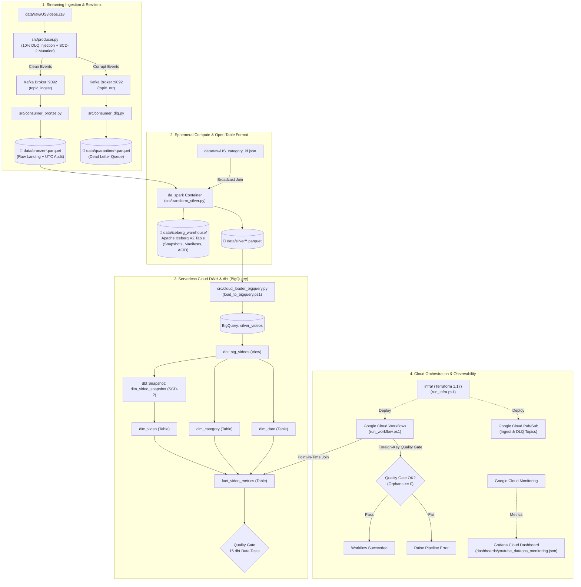
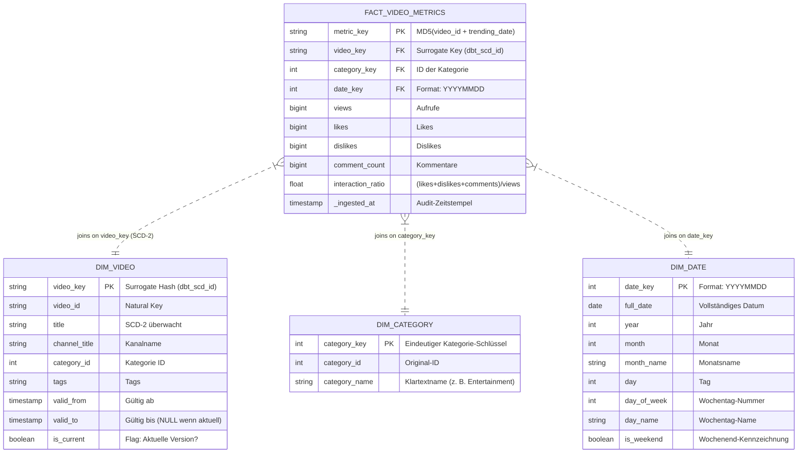

# YouTube DataOps & Analytics Platform (2026 Edition)

[-231F20?logo=apachekafka)](https://kafka.apache.org/)
[](https://spark.apache.org/)
[](https://iceberg.apache.org/)
[](https://www.getdbt.com/)
[](https://cloud.google.com/bigquery)
[](https://cloud.google.com/workflows)
[](https://grafana.com/)
[](https://www.terraform.io/)
[](https://www.docker.com/)
[](https://github.com/features/actions)

Eine unternehmensweite, produktionsreife **End-to-End DataOps & Analytics Plattform** auf Basis des Kaggle YouTube Trending Video Datensatzes.

Dieses Repository dokumentiert die vollständige Evolution eines universitären On-Premises Big-Data-Projekts (2021) hin zu einem modernen **Medallion Lakehouse** mit **Apache Iceberg V2**, **Kimball Star-Schema (SCD-2 via dbt)**, **serverloser GCP-Orchestrierung via Terraform & Cloud Workflows** sowie **Cloud-Observability via Grafana Cloud**.

---

## 📦 Versions-Historie & Evolutionsstufen

```
v1.0.0 (Core Foundation)             v2.0.0 (Lakehouse & Kimball Marts)        v2.1.0 (Serverless Cloud & Observability)
┌───────────────────────────────┐    ┌────────────────────────────────────────┐ ┌──────────────────────────────────────────────┐
│ • Kafka KRaft (Zero-ZooKeeper)│    │ • Apache Iceberg V2 Table Format (ACID)│ │ • Terraform IaC (GCS, BigQuery, PubSub, WFs) │
│ • Dead Letter Queue (DLQ)     │───►│ • dbt SCD-2 Dimension & Snapshots      │►│ • Google Cloud Workflows (0 € Idle-Kosten)   │
│ • Ephemerer Docker PySpark    │    │ • 15 Automatisierte dbt Quality Gates  │ │ • In-Workflow Quality Gate (Zero-Orphan FK)  │
│ • Airflow 2.9 (Docker)        │    │ • Ephemerer Spark Catalyst Engine      │ │ • Cloud-Native Grafana Cloud Observability   │
│ • Parquet Bulk BigQuery Sync  │    │ • BigQuery Star-Schema Materialisierung│ │ • GitHub Actions CI/CD & Automated Release   │
└───────────────────────────────┘    └────────────────────────────────────────┘ └──────────────────────────────────────────────┘
```

### 🔹 Release `v1.0.0`: Eingefrorenes Fundament
Löste die historischen Schmerzen des 2021/2022er Windows-Bare-Metal-Setups (Hadoop/Winutils/Batch-Skripte):
* **Containerisierte Ingestion:** Apache Kafka im KRaft-Modus (ohne ZooKeeper) via Docker Compose.
* **Resiliente Streaming-Pipeline:** Producer mit 10 % Fault-Injection und automatischer Umleitung fehlerhafter Datensätze in eine **Dead Letter Queue (DLQ)** (`data/quarantine/*.parquet`).
* **Ephemerer Spark-Compute:** PySpark läuft in einem On-Demand-Container über den Docker-Socket (`/var/run/docker.sock`) mit nativer Catalyst-Engine und Zero-Shuffle Broadcast-Joins.
* **Observability:** Lokaler Prometheus & Grafana Stack mit automatischem Datasource-Provisioning.

### 🔹 Release `v2.0.0`: Open Table Formats & Kimball DWH
Hob die Datenarchitektur auf Enterprise-Niveau:
* **Apache Iceberg V2 Table Format:** Transaktionssicherheit (ACID), Snapshot-Isolation und Time-Travel (`v1.metadata.json`) in `data/iceberg_warehouse/silver/videos/`.
* **SCD-2 Historisierung:** Deterministische Titel-Mutation im Producer (`2kyS6SvSYSE`) mit automatischer Erfassung via dbt Snapshots (`valid_from`, `valid_to`, `is_current`).
* **Kimball Star-Schema:** Conformed Dimensionen (`dim_video`, `dim_category`, `dim_date`) und Interaktions-Fakten (`fact_video_metrics`).
* **In-Warehouse Quality Gates:** 15 automatisierte dbt Tests (`PASS=15 ERROR=0`).

### 🔹 Release `v2.1.0`: Serverless Cloud & Observability (Aktueller Stand)
Vollständiger Übergang in eine professionelle, kosteneffiziente Cloud-Architektur:
* **Infrastructure as Code (Terraform):** Deklarative Bereitstellung aller Cloud-Ressourcen (GCS Bucket, BigQuery Dataset, Pub/Sub Topics, Cloud Workflow).
* **Google Cloud Workflows:** Serverlose Orchestrierung für DWH-Joins und Fremdschlüssel-Validierung ohne laufende Serverkosten (0 € Idle).
* **Grafana Cloud Observability:** Native Cloud-Anbindung an Google Cloud Monitoring ("Weg 1: 0 lokale Daemons") mit interaktivem Dashboard.
* **CI/CD Automation:** GitHub Actions für Code-Quality-Prüfung und Release-Automatisierung.

---

## 🏛️ Architektur-Vergleich (2021 vs. 2026 v1.0 vs. 2026 v2.1)

| Dimension | 2021 Legacy (Purdue/Simplilearn) | 2026 Release v1.0.0 | 2026 Release v2.1.0 (Aktuell) |
| :--- | :--- | :--- | :--- |
| **Plattform** | Windows 10 Bare-Metal + Batch | Docker Desktop + Host Python | Docker Compose + Google Cloud Platform |
| **Streaming** | Kafka + ZooKeeper (Batch-Timeouts) | Kafka KRaft + Dead Letter Queue | Kafka KRaft mit SCD-2 Event-Mutationen |
| **Storage Format** | Unkomprimierte CSVs via Flume | Snappy Parquet (Medallion) | **Apache Iceberg V2** (ACID & Snapshots) |
| **DWH Modeling** | Flache CSVs / NoSQL Cosmos DB | Flache Gold Parquet Dateien | **Kimball Star-Schema** (Fakten & Dimensionen) |
| **Historisierung** | Keine (SCD-1 Überschreiben) | Keine | **SCD-2 via dbt Snapshots** in BigQuery |
| **Transformation** | Databricks (Langsame Python UDFs) | Ephemerer Spark (Catalyst) | Spark (Iceberg Cleanse) + **dbt Core (ELT)** |
| **Orchestrierung** | Keine (Manuelle Shell-Skripte) | Lokaler Airflow 2.9 (Docker) | **Serverless Google Cloud Workflows** |
| **Quality Gates** | Keine (Blindes Vertrauen) | Einfacher Rowcount-Check | **15 dbt Tests + In-Workflow Quality Gate** |
| **Observability** | Keine | Lokaler Prometheus/Grafana Container | **Grafana Cloud via GCP Monitoring (Weg 1)** |
| **Cloud IaC** | Manuelle Klicks in Azure/AWS | Keine | **Terraform 1.17** (`run_infra.ps1`) |
| **CI/CD** | Keine | Manuelle Commits | **GitHub Actions** (Linting, Tests, Releases) |

---

## 📐 End-to-End Systemarchitektur



---

## 🏛️ Das Kimball Star-Schema (Data Warehouse)



---

## 🚀 Deppensichere Schritt-für-Schritt Anleitung (End-to-End)

Befolge diese Schritte der Reihe nach in deiner Windows PowerShell. Alle Skripte sind idempotent und fangen Fehler automatisch ab.

### 📋 Voraussetzungen
1. **Windows 10 oder 11** mit PowerShell 5.1 oder PowerShell 7.
2. **Docker Desktop** installiert und gestartet (WSL2-Backend empfohlen).
3. **Python 3.10+** auf dem System installiert.
4. **Google Cloud Platform (GCP) Projekt:**
   * Projekt-ID: `cloudanalytics-514018`
   * Region: `europe-west3` (Frankfurt) / Location: `EU`
5. **GCP Service Account Key:**
   * Erstelle im Projekt einen Service Account Key im JSON-Format.
   * Speichere ihn direkt als **`gcp_service_account.json`** im Hauptverzeichnis des Projekts ab (`D:\Projekte\CloudEng\DE_Capstone_2026\gcp_service_account.json`).
   * *(Die Datei ist über `.gitignore` automatisch vor jedem Git-Commit geschützt).*
6. **Erforderliche IAM-Rollen für den Service Account:**
   * `roles/bigquery.admin` (BigQuery Administrator)
   * `roles/storage.admin` (Storage Administrator)
   * `roles/pubsub.admin` (Pub/Sub Administrator)
   * `roles/workflows.admin` (Workflows Administrator)
   * `roles/iam.serviceAccountUser` (Dienstkonto-Nutzer)
   * `roles/monitoring.viewer` (Monitoring-Betrachter für Grafana Cloud)
7. **In GCP aktivierte APIs:**
   * `workflows.googleapis.com` (Cloud Workflows)
   * `monitoring.googleapis.com` (Cloud Monitoring)
   * `pubsub.googleapis.com` (Cloud Pub/Sub)
   * `bigquery.googleapis.com` (BigQuery)
   * `storage.googleapis.com` (Cloud Storage)

---

### Schritt 1: Python-Umgebung einrichten (Dauer: 2 Minuten)

Öffne eine PowerShell als normaler Benutzer:

```powershell
# 1. In das Projektverzeichnis wechseln
cd D:\Projekte\CloudEng\DE_Capstone_2026

# 2. Virtuelle Umgebung erstellen (falls nicht vorhanden)
python -m venv .venv

# 3. Execution-Policy für den aktuellen Prozess freigeben & venv aktivieren
Set-ExecutionPolicy -Scope Process -ExecutionPolicy Bypass
.\.venv\Scripts\Activate.ps1

# 4. Alle Abhängigkeiten (dbt-bigquery, google-cloud, pyspark, etc.) installieren
pip install -r requirements.txt
```

---

### Schritt 2: Cloud-Infrastruktur per Terraform bereitstellen (Dauer: 1 Minute)

Terraform rollt deklarativ den Storage Bucket, das BigQuery-Dataset, die Pub/Sub Topics und den Serverless Cloud Workflow aus:

```powershell
# 1. Terraform initialisieren & Provider laden
.\run_infra.ps1 init

# 2. Ausführungsplan berechnen & prüfen
.\run_infra.ps1 plan

# 3. Infrastruktur in Google Cloud bereitstellen (Tippe bei der Abfrage 'yes' ein)
.\run_infra.ps1 apply
```
*Nach erfolgreichem Durchlauf meldet Terraform: `Apply complete! Resources: 5 added, 0 changed, 0 destroyed.`*

---

### Schritt 3: Streaming Ingestion & Resilienz testen (Dauer: 2 Minuten)

Wir starten Kafka im KRaft-Modus, senden Events mit simulierten Fehlern und verarbeiten Gut- und Fehl-Daten getrennt:

```powershell
# 1. Apache Kafka & Kafka-UI Container im Hintergrund starten
.\start_kafka.ps1

# 2. Streaming Producer starten
# Sendet 295 echte Events, schleust 10% korrupte Daten ein und mutiert Titel für SCD-2
.\run_producer.ps1

# 3. Bronze Consumer starten (schreibt saubere Rohdaten nach data/bronze/)
.\run_bronze.ps1

# 4. Dead Letter Queue Consumer starten (schreibt korrupte Daten nach data/quarantine/)
.\run_dlq.ps1
```
* **Web-Oberfläche:** Öffne [http://localhost:8080](http://localhost:8080) im Browser, um Topics (`topic_ingest`, `topic_err`) live in der Kafka-UI zu sehen.

---

### Schritt 4: Silver Lakehouse mit Apache Iceberg V2 transformieren (Dauer: 1 Minute)

```powershell
.\run_silver.ps1
```
* Startet den ephemeren Docker-PySpark-Container.
* Führt einen broadcastfähigen Join gegen `US_category_id.json` durch.
* Schreibt atomar die **Apache Iceberg V2 Tabelle** nach `data/iceberg_warehouse/silver/videos/`.
* Schreibt Parquet-Dateien nach `data/silver/`.
* Gibt die Snapshot-Historie mit Commit-IDs und Manifest-Pfaden im Terminal aus.

---

### Schritt 5: Daten nach Google BigQuery laden (Dauer: 30 Sekunden)

```powershell
.\load_to_bigquery.ps1
```
* Lädt die bereinigten Silver-Events idempotent als Quelltabelle `silver_videos` in das BigQuery-Dataset `youtube_analytics`.

---

### Schritt 6: dbt Star-Schema, SCD-2 & Quality Gate ausführen (Dauer: 1 Minute)

Wir steuern dbt über das zentrale Runner-Skript [`run_dbt.ps1`](run_dbt.ps1):

```powershell
# 1. BigQuery-Verbindung testen
.\run_dbt.ps1 debug

# 2. SCD-2 Snapshot aktualisieren (erfasst Titelhistorie)
.\run_dbt.ps1 snapshot

# 3. Kimball Marts materialisieren (dim_video, dim_category, dim_date, fact_video_metrics)
.\run_dbt.ps1 run

# 4. Quality Gate ausführen (15 automatisierte Tests auf Eindeutigkeit, Not-Null & Fremdschlüssel)
.\run_dbt.ps1 test
```
*Ergebnis:* `Finished running 15 data tests... Passed: 15, Failed: 0, Errors: 0.`

---

### Schritt 7: Serverless Cloud Workflow in Google Cloud ausführen (Dauer: 10 Sekunden)

Dieser Schritt orchestriert die Berechnungen und das Quality Gate vollständig serverlos in der Cloud:

```powershell
.\run_workflow.ps1
```
* **Ablauf:**
  1. Authentifiziert sich per REST gegen Google Cloud Workflows.
  2. Startet den Workflow `youtube-dataops-pipeline` in Frankfurt (`europe-west3`).
  3. Der Workflow führt in BigQuery den Point-in-Time Join gegen `dim_video` aus und berechnet `fact_video_metrics`.
  4. Führt ein automatisiertes **Foreign-Key Quality Gate** aus (sucht nach verwaisten Datensätzen).
  5. Bei Erfolg gibt der Workflow zurück:  
     `Ergebnis: {"message":"DataOps Pipeline completed successfully. 0 quality errors detected.","status":"SUCCESS"}`

---

### Schritt 8: Observability in Grafana Cloud einrichten (Dauer: 2 Minuten)

1. Melde dich bei [grafana.com](https://grafana.com) an und öffne deine Grafana Cloud Instanz.
2. **Data Source verbinden:**
   * Drücke `Ctrl + K` oder navigiere zu **Connections** ➔ **Data sources** ➔ Klicke **Add data source**.
   * Wähle **Google Cloud Monitoring** aus.
   * **Authentication Type:** `Google JWT File`.
   * **Private key:** Lade deine Datei [`gcp_service_account.json`](gcp_service_account.json) hoch.
   * **Default Project:** `cloudanalytics-514018`.
   * Klicke auf **"Save & test"** *(grüne Meldung: "Data source is working")*.
3. **Dashboard importieren:**
   * Navigiere zu **Dashboards** ➔ **New** ➔ **Import**.
   * Klicke auf **Upload dashboard JSON file** und wähle:  
     [`dashboards/youtube_dataops_monitoring.json`](dashboards/youtube_dataops_monitoring.json).
   * Wähle im Dropdown deine Google Cloud Monitoring Datenquelle aus.
   * Klicke auf **Import**.
4. **Fertig:** Du siehst live Durchsatz, Latenzen, DWH-Abfragen, gescannte Datenmengen und DLQ-Fehlerraten!

---

### Schritt 9: Ressourcen aufräumen & 0-€ Kostengarantie

Wenn du mit dem Arbeiten oder Testen fertig bist:

```powershell
# 1. Lokale Kafka-Container stoppen & entfernen
.\stop_kafka.ps1

# 2. Sämtliche Cloud-Ressourcen (GCS Bucket, BigQuery Dataset, Pub/Sub, Workflows) rückstandslos löschen
.\run_infra.ps1 destroy
```
*Mit `destroy` fallen garantiert keinerlei Cloud-Kosten an. Wenn du das Projekt wieder demonstrieren möchtest, reicht ein erneutes `.\run_infra.ps1 apply`.*

---

## 🛠️ Vollständige Skript-Referenz (`.ps1` Runner)

Alle Operationen werden über standardisierte, robuste PowerShell-Runner gesteuert. Aufrufe wie `python ...` oder `terraform ...` sind direkt in den Skripten gekapselt:

| Runner-Skript | Parameter / Aufruf | Funktion & Verantwortlichkeit |
| :--- | :--- | :--- |
| [`run_infra.ps1`](run_infra.ps1) | `init`, `plan`, `apply`, `destroy` | Steuert Terraform CLI (inkl. Auto-Chdir in `infra/` und Argument-Weitergabe). |
| [`start_kafka.ps1`](start_kafka.ps1) | Keine | Startet Kafka Broker (KRaft) & Kafka-UI via Docker Compose im Hintergrund. |
| [`stop_kafka.ps1`](stop_kafka.ps1) | Keine | Stoppt alle Kafka-Container und gibt Ports frei. |
| [`run_producer.ps1`](run_producer.ps1) | Keine | Erzeugt Trending-Events, 10% DLQ-Fehlerinjektion und SCD-2 Titelmutationen. |
| [`run_bronze.ps1`](run_bronze.ps1) | Keine | Konsumiert `topic_ingest` und speichert Raw Landing Parquet mit UTC-Audit. |
| [`run_dlq.ps1`](run_dlq.ps1) | Keine | Konsumiert `topic_err` und speichert korrupte Records in Quarantäne (`data/quarantine/`). |
| [`run_silver.ps1`](run_silver.ps1) | Keine | Startet Docker PySpark, broadcast-joint Genres und committet **Apache Iceberg V2**. |
| [`load_to_bigquery.ps1`](load_to_bigquery.ps1)| Keine | Lädt Parquet-Dateien idempotent in das BigQuery-Dataset `youtube_analytics`. |
| [`run_dbt.ps1`](run_dbt.ps1) | `debug`, `snapshot`, `run`, `test` | Steuert dbt Core CLI (Verbindungstest, SCD-2 Snapshots, Marts, 15 Tests). |
| [`run_workflow.ps1`](run_workflow.ps1) | Keine | Triggert den Google Cloud Workflow via REST API und pollt den Status live bis zum Erfolg. |
| [`start_monitoring.ps1`](start_monitoring.ps1)| Keine | *(Optional / v1.0)* Startet lokalen Prometheus & Grafana Container-Stack. |
| [`stop_monitoring.ps1`](stop_monitoring.ps1) | Keine | *(Optional / v1.0)* Stoppt lokalen Monitoring-Stack. |
| [`start_airflow.ps1`](start_airflow.ps1) | Keine | *(Optional / v1.0 Legacy)* Startet lokalen Airflow-Stack. |
| [`stop_airflow.ps1`](stop_airflow.ps1) | Keine | *(Optional / v1.0 Legacy)* Stoppt lokalen Airflow-Stack. |

---

## 📂 Repository Layout

> **Architektur-Legende:**  
> 🟢 `[v2.1 Active]` = Aktiver Serverless Cloud & Observability Stack (Cloud Workflows, Terraform, Grafana Cloud, CI/CD)  
> 🟢 `[v2.0 Active]` = Aktiver Lakehouse & Kimball DWH Stack (Apache Iceberg V2, dbt Star-Schema, BigQuery)  
> 🟡 `[v1.0 Legacy / Deprecated]` = Stand Release v1.0.0 (in v2.0/v2.1 durch dbt & serverlose Cloud Workflows abgelöst)

```
DE_Capstone_2026/
├── .github/workflows/                    # 🟢 [v2.1 Active] ⭐ CI/CD Automation (GitHub Actions)
│   ├── ci.yml                            # 🟢 [v2.1 Active] Automatisierte Syntax-, Lint- & Schema-Prüfung
│   └── release.yml                       # 🟢 [v2.1 Active] Automatisierte Release-Erstellung bei Tag-Push
├── dashboards/                           # 🟢 [v2.1 Active] ⭐ Observability-as-Code
│   └── youtube_dataops_monitoring.json   # 🟢 [v2.1 Active] Grafana Cloud Dashboard für Workflows & BigQuery
├── dags/                                 # 🟡 [v1.0 Legacy] Apache Airflow DAGs (in v2.1 durch Cloud Workflows abgelöst)
│   ├── de_capstone_pipeline.py           # 🟡 [v1.0 Legacy] Lokale Airflow Pipeline (Bronze -> Silver -> Gold)
│   └── de_cloud_release_pipeline.py      # 🟡 [v1.0 Legacy] Alter BigQuery Parquet Sync
├── dbt/                                  # 🟢 [v2.0 Active] ⭐ Cloud DWH Transformationen (Kimball & SCD-2)
│   ├── dbt_project.yml                   # 🟢 [v2.0 Active] dbt Projektkonfiguration
│   ├── profiles.yml                      # 🟢 [v2.0 Active] BigQuery Verbindungsprofil (Region EU)
│   ├── snapshots/                        # 🟢 [v2.0 Active] ⭐ SCD-2 Snapshot-Definitionen
│   │   └── dim_video_snapshot.sql        # 🟢 [v2.0 Active] SCD-2 Snapshot-Definition (valid_from, valid_to)
│   └── models/
│       ├── staging/
│       │   ├── sources.yml               # 🟢 [v2.0 Active] BigQuery Quelltabellen-Definition (silver_videos)
│       │   └── stg_videos.sql            # 🟢 [v2.0 Active] Typisierung & Deduplizierungs-View
│       └── marts/core/                   # 🟢 [v2.0 Active] ⭐ Kimball Star-Schema Marts
│           ├── dim_video.sql             # 🟢 [v2.0 Active] SCD-2 Dimension mit is_current Flag
│           ├── dim_category.sql          # 🟢 [v2.0 Active] Conformed Kategorie-Dimension
│           ├── dim_date.sql              # 🟢 [v2.0 Active] Vorberechnete Datumsdimension
│           ├── fact_video_metrics.sql    # 🟢 [v2.0 Active] Interaktions-Fakten mit Point-in-Time Join
│           └── schema.yml                # 🟢 [v2.0 Active] ⭐ 15 automatisierte dbt Tests (Quality Gate)
├── infra/                                # 🟢 [v2.0 Active] ⭐ Infrastructure as Code (Terraform 1.17)
│   ├── versions.tf                       # 🟢 [v2.0 Active] Terraform & Google Provider Versionen
│   ├── variables.tf                      # 🟢 [v2.0 Active] Parameter (project_id, region, service_account)
│   ├── main.tf                           # 🟢 [v2.0 Active] GCS Bucket, BigQuery Dataset & Pub/Sub Topics
│   └── workflows/                        # 🟢 [v2.1 Active] ⭐ Serverless Cloud Workflows Orchestrierung
│       └── pipeline.yaml                 # 🟢 [v2.1 Active] Definition des Google Cloud Workflows & Quality Gate
├── docker/                               # Modulare Docker Compose Setups
│   ├── docker-compose-kafka.yml          # 🟢 [v2.0 Active] Apache Kafka KRaft & Kafka-UI
│   ├── docker-compose-spark.yml          # 🟢 [v2.0 Active] Ephemerer PySpark Compute Container
│   ├── docker-compose-airflow.yml        # 🟡 [v1.0 Legacy] Lokaler Airflow & PostgreSQL Stack
│   ├── docker-compose-monitoring.yml     # 🟡 [v1.0 Legacy] Lokaler Prometheus & Grafana Container Stack
│   ├── prometheus.yml                    # 🟡 [v1.0 Legacy] Prometheus Scrape-Konfiguration
│   └── grafana_datasources.yml           # 🟡 [v1.0 Legacy] Grafana Datasource Auto-Provisioning
├── src/                                  # Quellcode
│   ├── producer.py                       # 🟢 [v2.0 Active] Streaming-Producer (Fault Injection + SCD-2 Mutation)
│   ├── consumer_bronze.py                # 🟢 [v2.0 Active] Bronze Ingestion Consumer
│   ├── consumer_dlq.py                   # 🟢 [v2.0 Active] Dead Letter Queue Consumer (Quarantäne)
│   ├── transform_silver.py               # 🟢 [v2.0 Active] PySpark Job mit Apache Iceberg V2 Commit
│   ├── transform_gold.py                 # 🟡 [v1.0 Legacy] Altes Spark-Gold Skript (abgelöst durch dbt Marts)
│   ├── cloud_loader_bigquery.py          # 🟢 [v2.0 Active] BigQuery Idempotenter Parquet & Silver Uploader
│   └── cloud_workflow_runner.py          # 🟢 [v2.1 Active] REST-Client für Google Cloud Workflows Ausführung
├── run_producer.ps1                      # 🟢 [v2.0 Active] Runner: Streaming Producer (Fault Injection + SCD-2)
├── run_bronze.ps1                        # 🟢 [v2.0 Active] Runner: Bronze Kafka Ingestion
├── run_dlq.ps1                           # 🟢 [v2.0 Active] Runner: Dead Letter Queue (DLQ) Consumer
├── run_silver.ps1                        # 🟢 [v2.0 Active] Runner: PySpark Apache Iceberg Job
├── run_gold.ps1                          # 🟡 [v1.0 Legacy] Runner: Altes Spark-Gold (abgelöst durch run_dbt.ps1)
├── run_dbt.ps1                           # 🟢 [v2.0 Active] Runner: dbt CLI (debug, snapshot, run, test)
├── run_infra.ps1                         # 🟢 [v2.0 Active] Runner: Terraform CLI (init, plan, apply, destroy)
├── run_workflow.ps1                      # 🟢 [v2.1 Active] Runner: Serverless Cloud Workflow (BigQuery & Quality Gate)
├── load_to_bigquery.ps1                  # 🟢 [v2.0 Active] Runner: BigQuery Cloud Ingestion
├── start_kafka.ps1                       # 🟢 [v2.0 Active] Runner: Start Kafka & Kafka-UI
├── stop_kafka.ps1                        # 🟢 [v2.0 Active] Runner: Stopp Kafka & Kafka-UI
├── start_monitoring.ps1                  # 🟡 [v1.0 Legacy] Runner: Start lokales Monitoring (Prometheus/Grafana)
├── stop_monitoring.ps1                   # 🟡 [v1.0 Legacy] Runner: Stopp lokales Monitoring
├── start_airflow.ps1                     # 🟡 [v1.0 Legacy] Runner: Start Airflow (optional v1.0)
├── stop_airflow.ps1                      # 🟡 [v1.0 Legacy] Runner: Stopp Airflow
├── requirements.txt                      # 🟢 [v2.0 Active] Python-Abhängigkeiten (inkl. dbt-bigquery, Iceberg)
└── README.md                             # 🟢 [v2.1 Active] Vollständige Projektdokumentation
```

---

## 📜 Lizenz & Danksagung
* **Datensatz:** YouTube Trending Video Dataset (Kaggle).
* **Ausgangspunkt:** Modernisiert aus dem 2021/2022 Post Graduate Program in Data Engineering (Purdue University / Simplilearn).
* **Autor:** Bernd Weltler
