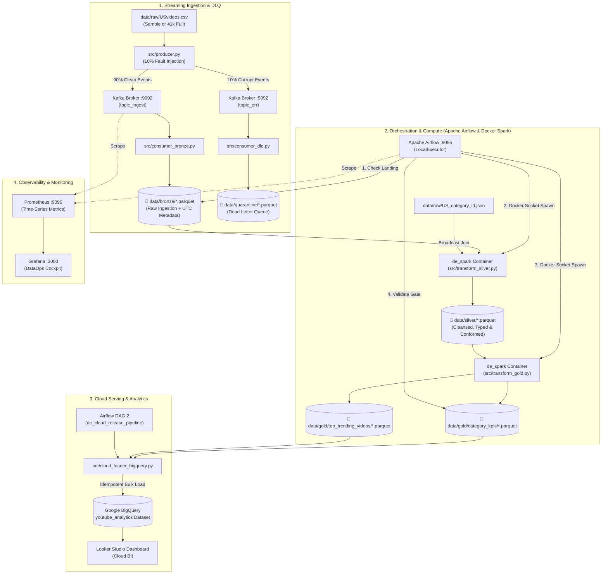

# YouTube DataOps & Analytics Platform (2026 Edition)

[-231F20?logo=apachekafka)](https://kafka.apache.org/)
[](https://spark.apache.org/)
[](https://airflow.apache.org/)
[](https://cloud.google.com/bigquery)
[](https://prometheus.io/)
[](https://grafana.com/)
[](https://www.docker.com/)

An enterprise-grade, containerized **End-to-End DataOps & Analytics Platform** built around the YouTube Trending Videos dataset. 

This project represents a complete, ground-up modernization of an earlier 2021 Post Graduate Data Engineering Capstone, transforming manual, fragile scripts into a reproducible, cloud-connected **Medallion Lakehouse** architecture.

---

## 🏛️ Architecture Evolution: 2021 vs. 2026

The primary motivation of this project was a deliberate architectural refactoring—replacing legacy Big Data antipatterns with state-of-the-art 2026 DataOps standards:

| Architectural Domain | 2021 Legacy Capstone (Purdue/Simplilearn) | 2026 Modern DataOps Platform (This Project) | Impact & Rationale |
| :--- | :--- | :--- | :--- |
| **Cluster Ingestion** | Native Windows Hadoop/Kafka with ZooKeeper & fragile `.bat` scripts | **Docker Compose with Apache Kafka in KRaft mode** (Zero ZooKeeper) | Starts in seconds; zero ZooKeeper sync overhead; isolated networking with dual-listeners. |
| **Data Quality & DLQ** | Blind file ingestion; invalid records caused downstream pipeline crashes | **Streaming Producer with 10% Fault Injection & Dead Letter Queue (DLQ)** | Resilient streaming; corrupted events are quarantined into `data/quarantine/*.parquet`. |
| **Storage Architecture** | Raw uncompressed CSVs via Flume file-roll & CloudBerry mapped drive | **Medallion Lakehouse (Bronze $\rightarrow$ Silver $\rightarrow$ Gold)** | Storage efficiency (+80% compression with Snappy Parquet); strict audit trails (`_ingested_at`). |
| **Compute Engine** | Azure Databricks with slow row-by-row Python `@udf` decorators | **Ephemeral Apache Spark Container with Native Spark SQL functions** | Eliminates JVM-to-Python IPC serialization; enables Spark's **Catalyst Optimizer** & **Project Tungsten**. |
| **Join Strategy** | Standard Shuffle Hash Joins on small category lookup files | **Broadcast Joins (`broadcast(df_categories)`)** | **Zero Network Shuffle**: In-memory lookup tables eliminate the #1 Big Data network bottleneck. |
| **Serving Layer** | Driver-side `.toPandas().T.to_dict()` loop writing to Azure Cosmos DB | **Automated Serverless Google BigQuery Loader** | Replaces driver-crashing loops with high-throughput bulk Parquet loads into cloud data marts. |
| **Orchestration** | Manual batch execution; no dependency management or automated retries | **Apache Airflow 2.9 (TaskFlow API)** via Docker Socket Runner | Automated DAGs with built-in **Data Quality Gates**, retries, and decoupled release pipelines. |
| **Observability** | Zero monitoring (blind operational state) | **Prometheus & Grafana Stack** with automated datasource provisioning | Real-time monitoring of service health, scrape latencies, and container metrics. |

---

## 📐 System Architecture Diagram



---

## 🛠️ Key Engineering Highlights

### 1. Ephemeral Spark Execution via Docker Socket
Instead of running a heavy 24/7 Spark cluster that idles and consumes system memory, Spark runs as an **ephemeral on-demand worker** (`docker-compose-spark.yml`):
* Airflow communicates directly with `/var/run/docker.sock`.
* When triggered, Docker creates the container `de_spark`, mounts the repository, executes `spark-submit`, writes optimized Parquet directly to disk, and **immediately destroys itself (`--rm`)**, returning 100% of RAM to the operating system.

### 2. Zero-Shuffle Broadcast Joins
Category mapping data ([`data/raw/US_category_id.json`](data/raw/US_category_id.json)) is small (~8 KB, 32 categories). Standard joins would trigger an expensive distributed network shuffle across executor partitions. By wrapping the category DataFrame in `broadcast()`, Spark distributes the lookup table into memory on all cores, enabling $O(1)$ in-memory lookups without network I/O.

### 3. Business-Ready Gold Data Marts
Two specialized marts are pre-calculated to eliminate heavy runtime calculations in downstream BI tools:
1. **`gold_category_kpis`**: Aggregates `total_videos`, `total_views`, `total_likes`, `total_comments`, and computes the **Engagement Rate** ($\frac{\text{likes} + \text{comments}}{\text{views}} \times 100$).
2. **`gold_top_trending_videos`**: Pre-materializes the Top 5 videos per category using Spark's native `Window.partitionBy("category_name").orderBy(col("views").desc())` and `dense_rank()`.

### 4. Decoupled Dual-DAG Orchestration
Airflow is separated into two clean DAGs:
* **`de_capstone_pipeline`**: Local Medallion pipeline (Bronze check $\rightarrow$ Silver transform $\rightarrow$ Gold transform $\rightarrow$ Data Quality Gate).
* **`de_cloud_release_pipeline`**: Dedicated Cloud Release DAG that synchronizes verified Gold Parquet marts to Google BigQuery.

---

## 🚀 Quickstart Guide

### Prerequisites
* Windows 10/11 with PowerShell
* Docker Desktop installed and running
* Python 3.10+ (for local scripts)

### Step 1: Environment Setup
Clone the repository and install dependencies in a virtual environment:
```powershell
git clone https://github.com/BHW80/DE_Capstone_2026.git
cd DE_Capstone_2026

python -m venv .venv
Set-ExecutionPolicy -Scope Process -ExecutionPolicy Bypass
.venv\Scripts\Activate.ps1
pip install -r requirements.txt
```

### Step 2: Start Streaming & Web-UI
Start the Kafka KRaft broker and Kafka-UI:
```powershell
docker compose -f docker/docker-compose-kafka.yml up -d
```
* **Kafka Broker:** `localhost:9092`
* **Kafka UI:** [http://localhost:8080](http://localhost:8080)

### Step 3: Stream Data & Ingest Bronze
Run the producer with fault injection and consume the clean/corrupted streams:
```powershell
# 1. Stream events into Kafka
python src/producer.py

# 2. Ingest clean events into Bronze Parquet
.\run_bronze.ps1

# 3. Drain corrupted events into Dead Letter Queue
python src/consumer_dlq.py
```

### Step 4: Run Medallion Transformations (Spark)
Execute the Silver and Gold transformations inside ephemeral Docker containers:
```powershell
.\run_silver.ps1   # Silver: Broadcast Join & Type Cleansing
.\run_gold.ps1     # Gold: Category KPIs & Window Ranking
```

### Step 5: Start Airflow & Monitoring
Launch the Airflow orchestrator and Grafana observability stack:
```powershell
.\start_airflow.ps1       # Starts Airflow & Postgres (UI: http://localhost:8085)
.\start_monitoring.ps1    # Starts Prometheus & Grafana (UI: http://localhost:3000)
```
* **Airflow UI:** [http://localhost:8085](http://localhost:8085) (Login: `admin` / `admin`)
* **Grafana UI:** [http://localhost:3000](http://localhost:3000) (Login: `admin` / `admin`)
* **Prometheus:** [http://localhost:9090](http://localhost:9090)

### Step 6: Cloud Release to Google BigQuery
To upload Gold Marts into Google Cloud BigQuery:
1. Place your GCP service account key at `gcp_service_account.json` (ignored by Git).
2. Execute the cloud loader:
```powershell
.\load_to_bigquery.ps1
```
*(Or trigger the `de_cloud_release_pipeline` DAG directly inside Airflow!)*

---

## 📂 Repository Layout

```
DE_Capstone_2026/
├── dags/                                 # Apache Airflow DAG definitions
│   ├── de_capstone_pipeline.py           # Medallion pipeline (Bronze -> Silver -> Gold -> Gate)
│   └── de_cloud_release_pipeline.py      # Cloud sync to Google BigQuery
├── data/                                 # Local data store (Ignored by Git)
│   ├── raw/                              # Original source datasets (USvideos.csv, categories JSON)
│   ├── sample/                           # Lightweight sample for testing (us_videos_mini_500.csv)
│   ├── bronze/                           # Raw Parquet landing files with UTC audit timestamps
│   ├── quarantine/                       # Dead Letter Queue Parquet records
│   ├── silver/                           # Cleansed, conformed Parquet tables
│   └── gold/                             # Analytical marts (category_kpis, top_trending_videos)
├── docker/                               # Modular Docker Compose configurations
│   ├── docker-compose-kafka.yml          # Kafka KRaft broker & Kafka-UI
│   ├── docker-compose-spark.yml          # Ephemeral PySpark compute container
│   ├── docker-compose-airflow.yml        # Airflow Standalone & PostgreSQL
│   ├── docker-compose-monitoring.yml     # Prometheus & Grafana stack
│   ├── prometheus.yml                    # Prometheus scraping targets
│   └── grafana_datasources.yml           # Automated Prometheus datasource provisioning
├── src/                                  # Pure Python and Spark transformation logic
│   ├── producer.py                       # Kafka event producer with fault injection
│   ├── consumer_bronze.py                # Bronze consumer with UTC audit trail
│   ├── consumer_dlq.py                   # Quarantine consumer for corrupted records
│   ├── transform_silver.py               # PySpark Silver cleansing & Broadcast Join
│   ├── transform_gold.py                 # PySpark Gold window functions & aggregations
│   └── cloud_loader_bigquery.py          # Google BigQuery idempotent Parquet uploader
├── load_to_bigquery.ps1                  # Convenience runner: BigQuery Cloud release
├── run_bronze.ps1                        # Convenience runner: Bronze Kafka ingestion
├── run_silver.ps1                        # Convenience runner: Spark Silver job
├── run_gold.ps1                          # Convenience runner: Spark Gold job
├── start_airflow.ps1                     # Convenience runner: Start Airflow services
├── stop_airflow.ps1                      # Convenience runner: Stop Airflow services
├── start_monitoring.ps1                  # Convenience runner: Start Prometheus & Grafana
├── stop_monitoring.ps1                   # Convenience runner: Stop Prometheus & Grafana
├── requirements.txt                      # Python dependencies
└── README.md                             # Complete project documentation
```

---

## 📜 License & Acknowledgments
* **Original Dataset:** YouTube Trending Video Dataset (Kaggle).
* **Reference Work:** Modernized from the 2021/2022 Post Graduate Program in Data Engineering (Purdue University / Simplilearn).
* **Author:** Bernd Weltler
