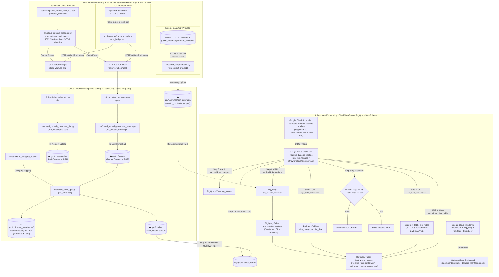
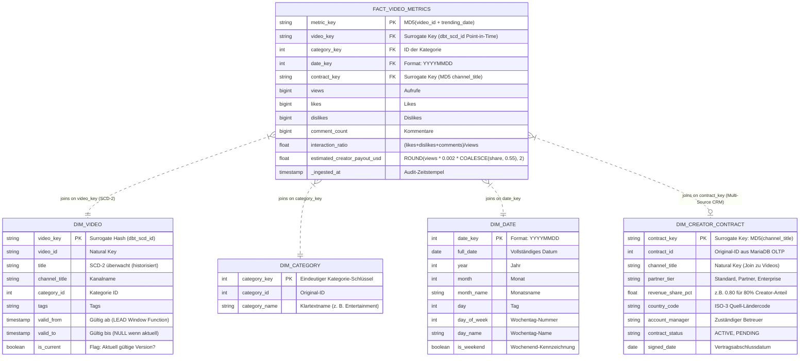

# YouTube DataOps & Analytics Platform (2026 Edition)

[](https://cloud.google.com/pubsub)
[-Apache%20Kafka%20(KRaft)-231F20?logo=apachekafka)](https://kafka.apache.org/)
[](https://spark.apache.org/)
[](https://iceberg.apache.org/)
[](https://www.getdbt.com/)
[](https://cloud.google.com/bigquery)
[](https://cloud.google.com/workflows)
[](https://grafana.com/)
[](https://www.terraform.io/)
[](https://github.com/features/actions)

Eine unternehmensweite, produktionsreife **End-to-End DataOps & Analytics Plattform** auf Basis des Kaggle YouTube Trending Video Datensatzes.

Dieses Repository dokumentiert die vollständige Evolution eines universitären On-Premises Big-Data-Projekts (2021) über fünf streng abgegrenzte Architektur-Releases (`v1.0.0` -> `v2.0.0` -> `v2.1.0` -> `v2.2.0` -> `v2.3.0`) hin zu einem modernen **Medallion Lakehouse** mit **Apache Iceberg V2**, **Kimball Star-Schema (SCD-2 & Conformed Dimensions)**, **serverloser GCP-Ingestion & Orchestrierung via Terraform, Cloud Pub/Sub & Cloud Workflows**, **Hybrid Edge-to-Cloud Bridge (On-Prem Kafka -> Cloud Pub/Sub)** sowie **Multi-Source SaaS/OLTP REST-API Ingestion (MariaDB CRM Integration)**.

> 📘 **Architektur-Handbuch & Technisches Repertorium (On-Demand Generator):**  
> Die tiefgehende 39-seitige Enterprise-Dokumentation inkl. Prozessvergleichen für alle Releases (`v1.0` bis `v2.3`), ADRs, Enterprise-Risikoanalyse, Runbooks und **25 Senior-Interview-Fragen** kann bei Bedarf lokal über `python src/generate_repertorium_pdf.py` als PDF kompiliert werden.

---

## 📦 Die fünf Releases im Detail: Prozesse, Architektur & Abgrenzung

```
v1.0.0 (Local Docker)       v2.0.0 (Kimball DWH)         v2.1.0 (Serverless Cloud)   v2.2.0 (Hybrid Bridge)      v2.3.0 (Multi-Source CRM & API)
┌───────────────────────┐   ┌────────────────────────┐   ┌───────────────────────┐   ┌───────────────────────┐   ┌──────────────────────────────┐
│ • Kafka KRaft (Lokal) │   │ • Iceberg V2 (ACID)    │   │ • 100% GCS Storage    │   │ • On-Prem Kafka-Bridge│   │ • MariaDB OLTP @ weltler.at  │
│ • Dead Letter Queue   │──►│ • dbt Core SCD-2       │──►│ • Cloud Pub/Sub & WF  │──►│ • Cloud Scheduler     │──►│ • HTTPS REST API Exporter    │
│ • PySpark Compute     │   │ • 15 dbt Data Tests    │   │ • Pattern B: Stored P.│   │ • Zero-Touch Autom.   │   │ • dim_creator_contract       │
│ • Airflow 2.9 & Prom. │   │ • BigQuery Star-Schema │   │ • Grafana Cloud       │   │ • Multi-Env Vorber.   │   │ • estimated_creator_payout   │
└───────────────────────┘   └────────────────────────┘   └───────────────────────┘   └───────────────────────┘   └──────────────────────────────┘
```

---

### 🔹 Abschnitt 1: Release `v1.0.0` – Local Docker Foundation (Containerisiertes Fundament)

**Zielsetzung:** Beseitigung der historischen Schmerzpunkte des 2021er Windows-Bare-Metal-Setups (`winutils.exe`, ZooKeeper-Abbrüche, fehlende Fehlerisolation). Alle Komponenten laufen lokal in Docker-Containern.

* **Prozessablauf (`v1.0.0`):**
  1. **Streaming Ingestion (Lokal):** `start_kafka.ps1` startet einen lokalen Apache Kafka Broker im KRaft-Modus (`127.0.0.1:9092`). `run_producer.ps1` (`src/producer.py`) sendet 295 valide Events nach `topic_ingest` und leitet 31 fehlerhafte Events (10 % Fault-Injection) in die lokale Dead Letter Queue `topic_err`.
  2. **Raw Storage:** `run_bronze.ps1` und `run_dlq.ps1` konsumieren aus Kafka und schreiben lokale Parquet-Dateien nach `data/bronze/` und `data/quarantine/`.
  3. **Spark Compute (Bronze -> Silver -> Gold):** `run_silver.ps1` und `run_gold.ps1` berechnen im ephemeren Docker-PySpark-Container flache Parquet-Aggregationen (`data/gold/`).
  4. **Lokale Orchestrierung & Monitoring:** `start_airflow.ps1` startet einen lokalen Airflow-2.9-Stack (`dags/`), `start_monitoring.ps1` startet lokale Prometheus- und Grafana-Container.
* **Was in `v1.0.0` zwingend nötig ist:** Docker Desktop, lokales Kafka (`docker-compose-kafka.yml`), PySpark (`transform_silver.py`, `transform_gold.py`), lokaler Airflow- und Monitoring-Stack.
* **Was in `v1.0.0` NICHT nötig ist:** Kein Google Cloud Account, kein BigQuery, kein Apache Iceberg, kein dbt Core, kein Terraform, kein Cloud Pub/Sub, keine Cloud Workflows, keine Grafana Cloud.

---

### 🔹 Abschnitt 2: Release `v2.0.0` – Hybrid Lakehouse & Kimball DWH (Open Table Format & SCD-2)

**Zielsetzung:** Einführung von ACID-Transaktionen im Data Lake (**Apache Iceberg V2**) und Ablösung der flachen Spark-Gold-Dateien durch ein dimensionales **Kimball Star-Schema mit SCD-2 Historisierung** in Google BigQuery via **dbt Core**.

* **Prozessablauf (`v2.0.0`):**
  1. **Streaming Ingestion mit SCD-2 Mutationen (Lokal via Kafka):** `src/producer.py` mutiert zusätzlich für das Zielvideo `2kyS6SvSYSE` deterministisch Titel und Tags über drei Zeitpunkte.
  2. **Silver Lakehouse mit Apache Iceberg V2:** `run_silver.ps1` (`src/transform_silver.py`) führt einen Zero-Shuffle Broadcast-Join gegen `US_category_id.json` aus und committet atomar in die **Apache Iceberg V2 Tabelle** `local.silver.videos` (`data/iceberg_warehouse/silver/videos/`) inklusive Snapshot-Historie (`v1.metadata.json`, `snap-*.avro`).
  3. **BigQuery Staging Upload:** `load_to_bigquery.ps1` (`src/cloud_loader_bigquery.py`) lädt die bereinigten Silver-Daten idempotent (`WRITE_TRUNCATE`) als Quelltabelle `silver_videos` nach Google BigQuery (`youtube_analytics`).
  4. **In-Warehouse ELT & Quality Gate (dbt Core):** `run_dbt.ps1 snapshot` historisiert Titeländerungen nach SCD-2 (`dim_video_snapshot`). `run_dbt.ps1 run` materialisiert das Star-Schema (`dim_video`, `dim_category`, `dim_date`, `fact_video_metrics` mit Point-in-Time Join). `run_dbt.ps1 test` prüft **15 automatisierte Datenqualitäts-Tests**.
* **Was in `v2.0.0` zwingend nötig ist:** Lokales Kafka + Docker PySpark mit Iceberg-Runtime, GCP Projekt + Service Account (`bigquery.admin`, `storage.admin`), `cloud_loader_bigquery.py`, dbt Core Projekt (`dbt/`).
* **Was in `v2.0.0` abgelöst / NICHT mehr nötig ist:**
  * 🔴 **Altes Spark-Gold-Skript (`src/transform_gold.py`, `run_gold.ps1`):** Vollständig durch dbt Core Marts in BigQuery abgelöst!
  * 🔴 **Lose Parquet-Dateien als alleiniger Silver-Layer:** Durch Apache Iceberg V2 ersetzt.

---

### 🔹 Abschnitt 3: Release `v2.1.0` – 100 % Cloud Lakehouse Storage, Pub/Sub & End-to-End Cloud Workflows (Aktuelle Produktion)

**Zielsetzung:** Vollständige Eliminierung sowohl lokaler Infrastruktur-Container (kein Kafka, kein Airflow, kein lokales Prometheus nötig) **als auch lokaler Parquet- und Iceberg-Zwischenordner**! Abseits der Ausgangslage (`data/sample/` und `data/raw/`) liegen **sämtliche Parquets und das Apache Iceberg V2 Warehouse im Google Cloud Storage Bucket (`gs://lakehouse-youtube-cloudanalytics-514018/`)**, und **Google Cloud Workflows steuert den gesamten Cloud-DWH-Ablauf End-to-End**.

* **Prozessablauf (`v2.1.0` – Aktueller Produktionsstandard, auch als One-Click via `.\run_pipeline.ps1`):**
  1. **Infrastructure as Code (Terraform 1.17):** `run_infra.ps1 apply` provisioniert vollautomatisch **10 Google Cloud Ressourcen**: GCS Lakehouse Bucket (`gs://lakehouse-youtube-cloudanalytics-514018`), BigQuery Dataset (`youtube_analytics`), 2 Cloud Pub/Sub Topics (`topic-youtube-ingest`, `topic-youtube-dlq`), 2 Cloud Pub/Sub Subscriptions (`sub-youtube-ingest`, `sub-youtube-dlq`), **3 BigQuery Stored Procedures (`sp_build_stg_videos`, `sp_build_dimensions`, `sp_refresh_fact_table` aus `infra/sql/*.sql`)** sowie den End-to-End Serverless Cloud Workflow (`youtube-dataops-pipeline`).
  2. **Serverless Cloud Streaming direkt in den GCS Lakehouse Bucket (0 lokale Parquet-Dateien!):**
     * `run_pubsub_producer.ps1` (`src/cloud_pubsub_producer.py`) sendet die validen Events (inkl. 3 SCD-2 Mutationen für `2kyS6SvSYSE`) direkt per HTTPS/REST an `topic-youtube-ingest` und die korrupten DLQ-Events (~10 %) an `topic-youtube-dlq`.
     * `run_pubsub_bronze.ps1` (`src/cloud_pubsub_consumer_bronze.py`) und `run_pubsub_dlq.ps1` (`src/cloud_pubsub_consumer_dlq.py`) ziehen & bestätigen (`acknowledge`) die Nachrichten aus `sub-youtube-ingest` bzw. `sub-youtube-dlq`, erzeugen die Parquet-Dateien **in-memory** und schreiben sie **direkt in den GCS-Bucket** (`gs://lakehouse-youtube-cloudanalytics-514018/bronze/` und `gs://.../quarantine/`).
  3. **Cloud Silver & Apache Iceberg V2 direkt im GCS Bucket (`run_silver.ps1` -> `src/cloud_silver_gcs.py`):**
     * Liest die Bronze-Parquets direkt aus `gs://lakehouse-youtube-cloudanalytics-514018/bronze/`, führt die Typisierung und den Kategorie-Join gegen `data/raw/US_category_id.json` aus und schreibt sowohl `silver/silver_videos.parquet` als auch das **Apache Iceberg V2 Warehouse (`iceberg_warehouse/silver/videos/metadata/` & `data/`) direkt in den GCS-Bucket `gs://lakehouse-youtube-cloudanalytics-514018/`**.
     * **Lokale Festplatten-Garantie:** Lokal unter `data/` verbleiben **ausschließlich `data/raw/` und `data/sample/` (die Ausgangslage)** – 0 lokale Parquet- oder Iceberg-Dateien!
  4. **Komplette End-to-End Cloud-Orchestrierung via Google Cloud Workflows & BigQuery Stored Procedures (`Pattern B` in `infra/workflows/pipeline.yaml` & `infra/sql/*.sql`):**
     Anstatt komplexe SQL-Strings unleserlich in der YAML-Datei zu zerstückeln, liegen die SQL-Transformationen sauber formatiert und debuggbar als echte `.sql`-Dateien unter `infra/sql/` und werden von Terraform als **BigQuery Stored Procedures** (`google_bigquery_routine`) ausgerollt. Der Cloud Workflow `youtube-dataops-pipeline` steuert den gesamten Prozess über schlanke `CALL`-Aufrufe:
     * **Step 1 (`load_gcs_silver_to_bq`):** Lädt `gs://lakehouse-youtube-cloudanalytics-514018/silver/*.parquet` per `LOAD DATA OVERWRITE` direkt Cloud-to-Cloud nach BigQuery (`silver_videos`).
     * **Step 2 (`check_silver_data`):** Prüft die geladene Datensatzanzahl in `silver_videos`.
     * **Step 3 (`build_stg_videos`):** Ruft `CALL youtube_analytics.sp_build_stg_videos();` (`infra/sql/01_sp_build_stg_videos.sql`) auf.
     * **Step 4 (`build_dimensions_scd2`):** Ruft `CALL youtube_analytics.sp_build_dimensions();` (`infra/sql/02_sp_build_dimensions.sql`) auf und baut `dim_category`, `dim_date` und die **SCD-2 Dimension `dim_video`** (inkl. aller 3 historischen Titelversionen von `2kyS6SvSYSE`).
     * **Step 5 (`refresh_fact_table`):** Ruft `CALL youtube_analytics.sp_refresh_fact_table();` (`infra/sql/03_sp_refresh_fact_table.sql`) auf und baut `fact_video_metrics` mittels Point-in-Time SCD-2 Join.
     * **Step 6 (`quality_gate_validation` & `evaluate_quality_gate`):** Prüft referenzielle Integrität (`0 orphan records`) und bricht bei Fehlern sofort per `raise` ab.
  5. **Cloud-Native Observability via Grafana Cloud & CI/CD:** Grafana Cloud fragt über das native Google Cloud Monitoring Plugin (`stackdriver`) direkt Workflow-Durchsatz, p99-Latenz, gescannte BigQuery-Bytes und die Pub/Sub-Nachrichtenströme ab. GitHub Actions validiert jeden Push automatisch.
* **Was in `v2.1.0` abgelöst / VOLLSTÄNDIG OPTIONAL ist:**
  * 🔴 **Lokale Parquet- & Iceberg-Ordner (`data/bronze`, `data/quarantine`, `data/silver`, `data/iceberg_warehouse`, `data/gold`):** **KOMPLETT IN DEN GCS-BUCKET (`gs://lakehouse-youtube-cloudanalytics-514018/`) VERLAGERT!** Lokal existieren nur noch `data/raw/` und `data/sample/`.
  * 🔴 **Lokaler Kafka-Container (`start_kafka.ps1`, `run_producer.ps1`, `run_bronze.ps1`, `run_dlq.ps1`):** **NICHT MEHR NÖTIG!** Vollständig durch Google Cloud Pub/Sub (`run_pubsub_*.ps1`) abgelöst.
  * 🔴 **Lokaler Airflow Stack (`start_airflow.ps1`, `dags/`):** **VOLLSTÄNDIG ÜBERFLÜSSIG!** Zu 100 % durch den 8-stufigen Google Cloud Workflow abgelöst.
  * 🔴 **Lokaler Prometheus/Grafana Stack (`start_monitoring.ps1`):** **VOLLSTÄNDIG ÜBERFLÜSSIG!** Durch Grafana Cloud (Weg 1) abgelöst.
  * 🟡 **Manueller Aufruf von `load_to_bigquery.ps1` & `run_dbt.ps1 run`:** Im Regelbetrieb übernimmt `run_workflow.ps1` bereits den GCS-Load und den Bau aller Star-Schema-Tabellen automatisch; `run_dbt.ps1 test` dient zur ergänzenden Ausführung der 15 dbt-Tests.

---

### 🔹 Abschnitt 4: Release `v2.2.0` – Enterprise Hybrid Integration & Automated Scheduling (Aktueller Standard)

**Zielsetzung:** Echte Hybrid-Cloud-Integration und vollständige Automatisierung! Anbindung lokaler On-Premises-Systeme über eine fehlertolerante **Edge-to-Cloud Bridge (On-Prem Kafka -> Cloud Pub/Sub)** sowie vollautomatischer täglicher Start der DWH-Pipeline via **Google Cloud Scheduler** (11 Terraform-Ressourcen).

* **Prozessablauf (`v2.2.0` – Enterprise Hybrid & Automation):**
  1. **Hybrid Edge-to-Cloud Bridge (`run_bridge.ps1` -> `src/bridge_kafka_to_pubsub.py`):**
     * Lokale Quellsysteme schreiben nach wie vor mit minimaler Latenz in On-Premises Kafka (`topic_ingest` und `topic_err`).
     * Die Bridge liest fehlertolerant aus beiden Kafka-Topics, bündelt die Events und spiegelt sie per HTTPS/OAuth2-Batching nach Google Cloud Pub/Sub (`topic-youtube-ingest` und `topic-youtube-dlq`).
     * **Enterprise-Nutzen:** Vollständige Entkopplung und Offline-Pufferspeicher bei Ausfall der Cloud-Internetverbindung (Zero Data Loss).
  2. **Automated Serverless Scheduling (Terraform 11 Ressourcen):**
     * Terraform provisioniert `google_cloud_scheduler_job.pipeline_schedule` (`schedule = "0 6 * * *"` in `Europe/Berlin`).
     * Startet den Cloud Workflow täglich um 06:00 Uhr morgens per OIDC-authentifiziertem HTTPS POST – **vollständig hands-free und zu 100 % im GCP Free Tier (0,00 €)**!
  3. **Medallion Lakehouse & Kimball DWH (GCS & BigQuery):**
     * Unverändert robust: Bronze & DLQ landen direkt in GCS, Silver & Iceberg V2 transformieren in GCS, Stored Procedures (`sp_build_stg_videos`, `sp_build_dimensions`, `sp_refresh_fact_table`) bauen das Star-Schema in BigQuery auf.

---

### 🔹 Abschnitt 5: Release `v2.3.0` – Multi-Source Enterprise API Ingestion & Conformed Kimball Dimensions (Aktueller Standard)

**Zielsetzung:** Auflösung des Single-Source-Silos! Großunternehmen führen Daten aus unterschiedlichen Quellsystemen zusammen. `v2.3.0` bindet eine externe relationale **MariaDB** (gehostet auf `www.weltler.at`) über eine gesicherte **HTTPS REST-API (Bearer Token)** an, spiegelt die Daten direkt in GCS Bronze und verheiratet die Verträge über eine **Conformed Dimension (`dim_creator_contract`)** und eine **neue Business-KPI (`estimated_creator_payout_usd`)** im BigQuery Star-Schema.

* **Prozessablauf (`v2.3.0` – Multi-Source & Multi-Interval):**
  1. **MariaDB OLTP Source & DDL Seed (`scripts/mariadb_schema_and_seed.sql`):**
     * Hält die relationalen Creator-Stammdaten: `channel_title`, `partner_tier`, `revenue_share_pct`, `country_code`, `account_manager`, `signed_date`.
  2. **API-Led Ingestion Pattern (`scripts/api_get_contracts.php` & `src/cloud_crm_extractor.py` / `run_extract_crm.ps1`):**
     * **Sicherheit:** Kein offener Port 3306! Abfrage über verschlüsseltes HTTPS mit `Authorization: Bearer <TOKEN>`.
     * **Serverless Parquet Upload:** Konvertiert die JSON-Antwort in-memory in Parquet und streamt sie direkt nach `gs://lakehouse-youtube-cloudanalytics-514018/bronze/crm_contracts/creator_contracts.parquet` (0 lokale Festplattendateien).
  3. **BigLake External Table & Conformed Dimension (`infra/sql/02_sp_build_dimensions.sql`):**
     * `CREATE OR REPLACE EXTERNAL TABLE ext_creator_contracts` liest die Parquet-Datei serverlos aus GCS.
     * Materialisiert die Conformed Dimension `dim_creator_contract` mit Surrogate Hash Key (`contract_key`).
  4. **Business-KPI & Point-in-Time Join (`infra/sql/03_sp_refresh_fact_table.sql`):**
     * Verknüpft `fact_video_metrics` per `LEFT JOIN` mit `dim_creator_contract`.
     * Berechnet für jedes Video die Auszahlung:  
       `estimated_creator_payout_usd = ROUND(views * 0.002 * COALESCE(revenue_share_pct, 0.55), 2)`.
  5. **Master Runner Integration (`run_pipeline.ps1`):**
     * `run_extract_crm.ps1` ist als Schritt 2 fest in der End-to-End Pipeline verankert.

---

## 🔍 Notwendigkeits-Matrix über alle fünf Releases (`v1.0.0` bis `v2.3.0`)

| Komponente / Schicht | Release `v1.0.0` (Local) | Release `v2.0.0` (Hybrid) | Release `v2.1.0` (Cloud) | Release `v2.2.0` (Hybrid & Sched.) | Release `v2.3.0` (Multi-Source CRM & API) **[AKTUELL]** |
| :--- | :--- | :--- | :--- | :--- | :--- |
| **Externe Datenquellen** | 🔴 Nur 1 CSV | 🔴 Nur 1 CSV | 🔴 Nur 1 CSV | 🔴 Nur 1 CSV | 🟢 **Multi-Source: YouTube + MariaDB via REST-API** (`run_extract_crm.ps1`) |
| **Streaming Broker** | 🟢 Lokales Kafka | 🟢 Lokales Kafka | 🟢 Cloud Pub/Sub | 🟢 Hybrid Kafka Bridge (`run_bridge.ps1`) | 🟢 **Hybrid Kafka Bridge + Cloud Pub/Sub** |
| **Lakehouse Storage** | 📁 Lokal | 📁 Lokal | ☁️ 100 % GCS Bucket | ☁️ 100 % GCS Bucket | ☁️ **100 % GCS (`bronze/`, `silver/`, `bronze/crm_contracts/`)** |
| **Silver & Iceberg V2** | 🟢 PySpark flach | 🟢 PySpark Iceberg V2 | 🟢 Cloud Silver & Iceberg V2 | 🟢 Cloud Silver & Iceberg V2 | 🟢 **Cloud Silver & Iceberg V2 in GCS** |
| **Gold / DWH Modellierung** | 🟢 Spark Parquet | 🟢 dbt Core Star-Schema | 🟢 Cloud Workflows SPs | 🟢 Cloud Workflows SPs | 🟢 **Star-Schema mit `dim_creator_contract` & Payout-KPI** |
| **Scheduling & Trigger** | 🟡 Manuell / Airflow | 🟡 Manuell CLI | 🟡 Manuell CLI | 🟢 Cloud Scheduler (tägl. 06:00) | 🟢 **Cloud Scheduler + End-to-End Master Pipeline** (`run_pipeline.ps1`) |
| **Observability** | 🟢 Lokal Prometheus/Grafana | 🟡 Lokal Prometheus/Grafana | 🟢 Grafana Cloud | 🟢 Grafana Cloud & Lokal | 🟢 **Grafana Cloud & Lokales Grafana via GCP Monitoring Plugin** |
| **Cloud IaC** | 🔴 Kein IaC | 🔴 Kein IaC | 🟢 Terraform (10 Ress.) | 🟢 Terraform (11 Ressourcen) | 🟢 **Terraform 1.17 (11 GCP-Ressourcen inkl. Cloud Scheduler & Stored Procs)** |

---

## 📐 End-to-End Systemarchitektur (Release `v2.3.0` – Multi-Source Cloud Lakehouse, Hybrid Bridge & Automated Workflows)



---

## 🏛️ Das Kimball Star-Schema (Release `v2.3.0` – Multi-Source Enterprise DWH)

Im Release `v2.3.0` wird das Star-Schema vom reinen YouTube-Silo zu einem **Multi-Source Enterprise Data Warehouse** ausgebaut:
* **Geschäftsprozess & Fakten-Granularität (Grain):** Exakt 1 Zeile pro YouTube-Video pro Trending-Tag (`metric_key = MD5(video_id + trending_date)`).
* **Point-in-Time SCD-2 Join:** Die Faktentabelle verbindet sich über `video_key` atomar mit der zum `trending_date` gültigen Version der `dim_video`.
* **Multi-Source Conformed Dimension:** `dim_creator_contract` führt Stammdaten und Vergütungsmodelle aus einer externen **MariaDB CRM-Datenbank** über die Conformed Natural Key Spalte `channel_title` zusammen.
* **Erweiterte Business-KPI:** `estimated_creator_payout_usd` monetarisiert die Performance über die vertraglichen Konditionen (`views * 0.002 * revenue_share_pct`).



---

## 🚀 Deppensichere Schritt-für-Schritt Anleitung (Release `v2.3.0` – Multi-Source Cloud Lakehouse & Automated Workflows!)

Befolge diese Schritte in deiner Windows PowerShell. Für Release `v2.3.0` musst du **weder Kafka, noch Airflow, noch lokales Prometheus, noch Docker starten** – sämtliche Parquets und Iceberg-Tabellen landen direkt im **Google Cloud Storage Bucket (`gs://lakehouse-youtube-cloudanalytics-514018/`)**, und **Google Cloud Workflows steuert den gesamten DWH-Aufbau End-to-End**!

### 📋 Voraussetzungen
1. **Windows 10 oder 11** mit PowerShell 5.1 oder PowerShell 7.
2. **Python 3.10+** sowie **Terraform 1.17** auf dem System installiert.
3. **Google Cloud Platform (GCP) Projekt:**
   * Projekt-ID: `cloudanalytics-514018`
   * Region: `europe-west3` (Frankfurt) / Location: `EU`
4. **GCP Service Account Key:**
   * Speichere den JSON-Schlüssel deines Service Accounts als **`gcp_service_account.json`** direkt im Hauptverzeichnis (`D:\Projekte\CloudEng\DE_Capstone_2026\gcp_service_account.json`).
5. **Die 7 erforderlichen IAM-Rollen für den Service Account:**
   * `roles/bigquery.admin` (BigQuery Administrator)
   * `roles/storage.admin` (Storage Administrator)
   * `roles/pubsub.admin` (Pub/Sub Administrator – für Topics & Subscriptions)
   * `roles/workflows.admin` (Workflows Administrator)
   * `roles/cloudscheduler.admin` (Cloud Scheduler Administrator – für automatisierte Cron-Jobs)
   * `roles/iam.serviceAccountUser` (Dienstkonto-Nutzer)
   * `roles/monitoring.viewer` (Monitoring-Betrachter für Grafana Cloud)
6. **Die 6 in GCP aktivierten APIs:**
   * `workflows.googleapis.com`, `monitoring.googleapis.com`, `pubsub.googleapis.com`, `bigquery.googleapis.com`, `storage.googleapis.com`, `cloudscheduler.googleapis.com`

---

### Schritt 1: Python-Umgebung einrichten (Dauer: 1 Minute)

```powershell
cd D:\Projekte\CloudEng\DE_Capstone_2026
python -m venv .venv
Set-ExecutionPolicy -Scope Process -ExecutionPolicy Bypass
.\.venv\Scripts\Activate.ps1
pip install -r requirements.txt
```

---

### Schritt 2: Cloud-Infrastruktur (11 GCP-Ressourcen inkl. Stored Procedures & Cloud Scheduler) per Terraform bereitstellen (Dauer: 30 Sekunden)

Terraform rollt deklarativ den GCS Bucket (`lakehouse-youtube-cloudanalytics-514018`), das BigQuery-Dataset (`youtube_analytics`), die 2 Pub/Sub Topics (`topic-youtube-ingest`, `topic-youtube-dlq`), die 2 Pub/Sub Subscriptions (`sub-youtube-ingest`, `sub-youtube-dlq`), die **3 BigQuery Stored Procedures (`sp_build_stg_videos`, `sp_build_dimensions`, `sp_refresh_fact_table` aus `infra/sql/*.sql`)**, den Serverless Cloud Workflow (`youtube-dataops-pipeline`) sowie den **Cloud Scheduler (`schedule-youtube-dataops-pipeline`)** aus:

```powershell
.\run_infra.ps1 init
.\run_infra.ps1 plan
.\run_infra.ps1 apply
```
*Ergebnis:* `Apply complete! Resources: 11 added, 0 changed, 0 destroyed.`

---

### ⚡ Option A (One-Click Master-Runner): Gesamte Pipeline in einem Befehl starten!

Sobald Terraform ausgerollt ist, kannst du die **gesamte End-to-End Cloud Pipeline** (`Pub/Sub Producer` -> `Multi-Source CRM Ingest via HTTPS-API` -> `Pub/Sub Bronze & DLQ nach GCS` -> `Silver & Iceberg V2 in GCS` -> `Google Cloud Workflow End-to-End Star-Schema & Quality Gate`) mit einem einzigen Befehl ausführen:

```powershell
.\run_pipeline.ps1
```

---

### 🔍 Option B: Einzelne Schritte der Pipeline gezielt ausführen

#### Schritt 3: Serverless Cloud Streaming & Multi-Source CRM-Extraktion direkt nach GCS

```powershell
# 1. Sendet 439 Clean Events (inkl. SCD-2 Mutationen) an 'topic-youtube-ingest'
#    und 61 korrupte Events (10% Fault-Injection) an 'topic-youtube-dlq'
.\run_pubsub_producer.ps1

# 2. Extrahiert relationale CRM-Verträge via HTTPS REST-API von MariaDB @ weltler.at
#    und schreibt Parquet direkt nach gs://.../bronze/crm_contracts/creator_contracts.parquet (0 lokale Dateien!)
.\run_extract_crm.ps1

# 3. Zieht & bestätigt die Clean Events aus 'sub-youtube-ingest' -> direkt nach gs://.../bronze/*.parquet (0 lokale Dateien!)
.\run_pubsub_bronze.ps1

# 4. Zieht & bestätigt die fehlerhaften Events aus 'sub-youtube-dlq' -> direkt nach gs://.../quarantine/*.parquet (0 lokale Dateien!)
.\run_pubsub_dlq.ps1
```

#### Schritt 4: Cloud Silver & Apache Iceberg V2 direkt im GCS Lakehouse Bucket (`silver/` & `iceberg_warehouse/`)

```powershell
.\run_silver.ps1
```
* Liest die Bronze-Parquets direkt aus `gs://lakehouse-youtube-cloudanalytics-514018/bronze/`, führt die Typisierung und das Kategorie-Mapping gegen `data/raw/US_category_id.json` aus und schreibt sowohl **`gs://.../silver/silver_videos.parquet`** als auch das **Apache Iceberg V2 Warehouse (`gs://.../iceberg_warehouse/silver/videos/`)** direkt in den Cloud-Bucket.
* **Lokale Sauberkeits-Garantie:** Lokal unter `data/` verbleiben **ausschließlich `data/raw/` und `data/sample/` (die Ausgangslage)**!

#### Schritt 5: Kompletter End-to-End DWH-Aufbau & Quality Gate via Google Cloud Workflows (Pattern B: Stored Procedures)

```powershell
.\run_workflow.ps1
```
* Der Cloud Workflow `youtube-dataops-pipeline` steuert **den gesamten DWH-Prozess über die in `infra/sql/*.sql` definierten BigQuery Stored Procedures vollautomatisch in der Cloud**:
  1. `load_gcs_silver_to_bq`: Lädt `gs://lakehouse-youtube-cloudanalytics-514018/silver/*.parquet` per `LOAD DATA OVERWRITE` direkt nach BigQuery (`silver_videos`).
  2. `check_silver_data`: Prüft die Zeilenanzahl in `silver_videos`.
  3. `build_stg_videos`: Ruft `CALL youtube_analytics.sp_build_stg_videos();` (`infra/sql/01_sp_build_stg_videos.sql`) auf.
  4. `build_dimensions_scd2`: Ruft `CALL youtube_analytics.sp_build_dimensions();` (`infra/sql/02_sp_build_dimensions.sql`) auf (`dim_category`, `dim_date`, `dim_video` SCD-2 mit allen 3 Versionen von `2kyS6SvSYSE`).
  5. `refresh_fact_table`: Ruft `CALL youtube_analytics.sp_refresh_fact_table();` (`infra/sql/03_sp_refresh_fact_table.sql`) auf (`fact_video_metrics` mit Point-in-Time SCD-2 Join).
  6. `quality_gate_validation`: Prüft referenzielle Integrität (`0 orphan records`) und wirft bei Fehlern `raise`.
* *Ergebnis:* `{"message":"Full End-to-End Cloud Lakehouse & Star-Schema Pipeline (Pattern B: Stored Procedures) completed successfully. 0 quality errors detected.","status":"SUCCESS"}`

#### Schritt 6: Ergänzende Verifikation der 15 dbt Data Tests

```powershell
.\run_dbt.ps1 test
```
*Ergebnis:* `Done. PASS=15 WARN=0 ERROR=0 SKIP=0 TOTAL=15`

---

### 🌐 Option C (Release `v2.2.0`): Hybrid Edge-to-Cloud Streaming (On-Premises Kafka -> Cloud Pub/Sub)

Demonstriert die Anbindung von On-Premises-Systemen über eine ausfallsichere Bridge:

```powershell
# 1. Lokales Kafka starten & Events im On-Premises-Cluster erzeugen
.\start_kafka.ps1
.\run_producer.ps1

# 2. Hybrid Bridge starten (spiegelt Events resilient von Kafka nach Cloud Pub/Sub)
.\run_bridge.ps1

# 3. Cloud-Verarbeitung starten (zieht aus Pub/Sub nach GCS & führt DWH-Workflows aus)
.\run_pubsub_bronze.ps1
.\run_pubsub_dlq.ps1
.\run_silver.ps1
.\run_workflow.ps1
```

---

### Schritt 7: Observability in Grafana Cloud prüfen (Dauer: 1 Minute)

1. Öffne deine Grafana Cloud Instanz ([grafana.com](https://grafana.com)).
2. Unter **Connections** -> **Data sources** -> **Google Cloud Monitoring** ist deine [`gcp_service_account.json`](gcp_service_account.json) hinterlegt (`Default Project: cloudanalytics-514018`).
3. Unter **Dashboards** -> **Import** lädst du [`dashboards/youtube_dataops_monitoring.json`](dashboards/youtube_dataops_monitoring.json) hoch.
4. **Live-Effekt:** Sowohl die **Workflow- & BigQuery-Panels** als auch die beiden **Pub/Sub-Panels (`topic-youtube-ingest` vs. `topic-youtube-dlq`)** zeigen sofort echte Live-Metriken!

---

### Schritt 8: Ressourcen aufräumen & 0-€ Kostengarantie

```powershell
# Sämtliche 11 Cloud-Ressourcen (GCS Bucket, BigQuery Dataset & Stored Procedures, Pub/Sub Topics & Subscriptions, Workflows, Cloud Scheduler) rückstandslos löschen:
.\run_infra.ps1 destroy
```

---

## ⚠️ Kritische Analyse: Risiken & Schwachstellen im Enterprise-Umfeld

Keine Architektur ist ohne Trade-offs. Für einen Einsatz im großskaligen Enterprise-Umfeld (Terabyte- bis Petabyte-Volumen, strenge Compliance) müssen folgende 8 strukturelle Schwachstellen des aktuellen Setups benannt und adressiert werden:

1. **Client-gesteuerte Ingest-/Silver-Skripte statt Cloud Run Jobs & BigQuery BigLake:**
   * *Schwachstelle:* Obwohl in `v2.1.0` sämtliche Parquets und Iceberg-Dateien zu 100 % im GCS-Bucket (`gs://lakehouse-youtube-cloudanalytics-514018/`) liegen und der Cloud Workflow den gesamten DWH-Aufbau ab GCS steuert, werden die Python-Skripte für Pub/Sub-Ingest und Silver-Transformation noch über die CLI (`run_pipeline.ps1`) angestoßen (da Cloud Run / Dataproc kostenpflichtige Compute-APIs erfordern).
   * *Enterprise-Mitigation:* Verpacken von `cloud_pubsub_consumer_*.py` und `cloud_silver_gcs.py` als serverlose **Google Cloud Run Jobs**, die direkt aus `pipeline.yaml` heraus vor Schritt 1 aufgerufen werden, sowie Nutzung von **BigQuery BigLake External Tables** direkt auf den Apache Iceberg Metadaten in GCS.
2. **Lokaler Terraform State (`infra/terraform.tfstate`) & Statischer JSON-Key (`gcp_service_account.json`):**
   * *Schwachstelle:* Der Terraform-State liegt lokal auf der Festplatte (kein Team-Locking, Verlustgefahr), und die Authentifizierung nutzt einen langlebigen JSON-Key.
   * *Enterprise-Mitigation:* Auslagerung des Terraform-Backends in einen versionierten GCS-State-Bucket mit State-Locking sowie Umstellung auf **Keyless Workload Identity Federation (OIDC)** für GitHub Actions und Entwickler-Impersonation.
3. **dbt Snapshot Deduplizierung vs. Window-Function SCD-2 Timeline:**
   * *Schwachstelle:* Ein klassischer `dbt snapshot`-Lauf mit `QUALIFY row_number() = 1` erfasst pro Aufruf nur die jeweils jüngste Änderung eines Batches. (In unserer `v2.1.0` `dim_video.sql` und `pipeline.yaml` haben wir dies bereits durch eine deterministische `LEAD()`-Window-Function gelöst, die alle 3 Intra-Batch-Mutationen von `2kyS6SvSYSE` lückenlos historisiert!).
   * *Enterprise-Mitigation:* Bei echtem Endlos-Streaming Kombination aus kontinuierlichem CDC (Datastream) und inkrementellem `MERGE INTO` auf der SCD-2-Dimension.
4. **Fehlende Partitionierung & Clustering auf `fact_video_metrics` für Terabyte-Skalierung:**
   * *Schwachstelle:* Bei ~440 Zeilen ist ein Full-Table-Rebuild (`CREATE OR REPLACE TABLE`) in BigQuery kostenlos (< 1 MB). Bei 5 Milliarden Zeilen würde jeder Lauf von `pipeline.yaml` mehrere Terabyte scannen und hohe On-Demand-Kosten (6,25 \$ / TB) verursachen.
   * *Enterprise-Mitigation:* Umstellung in dbt und Cloud Workflows auf inkrementelles `MERGE` mit `PARTITION BY trending_date` und `CLUSTER BY category_key, video_key`.
5. **Überprivilegierte IAM-Rollen (`*.admin` statt Granular Least Privilege):**
   * *Schwachstelle:* Der Service Account nutzt der Einfachheit halber `bigquery.admin`, `storage.admin`, `pubsub.admin` und `workflows.admin`.
   * *Enterprise-Mitigation:* Trennung in einen **Terraform-Deployment-SA** und einen stark eingeschränkten **Runtime-Workflow-SA** (nur `bigquery.dataEditor`, `bigquery.jobUser`, `storage.objectViewer`).
6. **Fehlende Schema-Registry im Streaming-Layer (JSON-Payload statt Protobuf/Avro):**
   * *Schwachstelle:* Producer und Consumer tauschen schemaloses JSON aus; fehlerhafte Felder werden erst durch Applikationslogik erkannt.
   * *Enterprise-Mitigation:* Aktivierung von **Google Cloud Pub/Sub Schema Validation** (Avro oder Protocol Buffers), sodass nicht-konforme Nachrichten bereits am API-Gateway der Cloud abgewiesen werden.
7. **In-Workflow Quality Gate prüft erst *nach* dem Überschreiben (`Post-Write Validation`):**
   * *Schwachstelle:* `pipeline.yaml` führt erst `CREATE OR REPLACE TABLE fact_video_metrics` aus und prüft danach auf `invalid_keys`. Schlägt das Gate fehl, wirft der Workflow zwar einen Fehler, die Tabelle wurde aber bereits beschrieben (kein Write-Audit-Publish).
   * *Enterprise-Mitigation:* **Write-Audit-Publish (WAP) Pattern**: Schreiben in eine Staging-Tabelle `fact_video_metrics_wap`, Ausführen des Quality Gates auf der Staging-Tabelle und erst bei `invalid_count == 0` atomares Clonen (`CREATE OR REPLACE TABLE ... CLONE`) nach `fact_video_metrics`.
8. **CI/CD prüft Syntax, führt aber noch kein automatisiertes `dbt test` gegen ein Cloud-Staging-Dataset aus:**
   * *Schwachstelle:* `.github/workflows/ci.yml` prüft Python-Syntax, Flake8, YAML und JSON, führt aber mangels hinterlegter Cloud-Credentials in GitHub noch keinen Live-SQL-Test gegen BigQuery aus.
   * *Enterprise-Mitigation:* Kopplung von GitHub Actions via OIDC an ein dediziertes GCP-CI-Projekt zur Ausführung von `dbt build --select state:modified+` bei jedem Pull Request.

---

## 🛠️ Vollständige Skript-Referenz (`.ps1` Runner)

| Runner-Skript | Parameter / Aufruf | Release-Status & Verantwortlichkeit |
| :--- | :--- | :--- |
| [`run_pipeline.ps1`](run_pipeline.ps1) | Keine | 🟢 **`[v2.3 Active]` ⭐ Master-Runner:** Führt die komplette Cloud-Pipeline (`Pub/Sub Producer` -> `CRM REST-API Ingest` -> `GCS Bronze/DLQ` -> `GCS Silver/Iceberg` -> `Cloud Workflow E2E`) in einem Befehl aus. |
| [`run_infra.ps1`](run_infra.ps1) | `init`, `plan`, `apply`, `destroy` | 🟢 **`[v2.3 Active]`** Steuert Terraform 1.17 in `infra/` (11 GCP-Ressourcen inkl. Cloud Scheduler, Pub/Sub & 3 Stored Procedures). |
| [`run_pubsub_producer.ps1`](run_pubsub_producer.ps1) | Keine | 🟢 **`[v2.1 Active]`** Streamt Clean Events & DLQ Events serverlos an **Google Cloud Pub/Sub**. |
| [`run_extract_crm.ps1`](run_extract_crm.ps1) | Keine | 🟢 **`[v2.3 Active]`** Fragt Creator-Verträge via HTTPS REST-API von MariaDB ab und schreibt serverlos direkt nach `gs://.../bronze/crm_contracts/`. |
| [`run_bridge.ps1`](run_bridge.ps1) | Keine | 🟢 **`[v2.2 Active]`** Spiegelt Events resilient vom lokalen Kafka-Cluster (`127.0.0.1:9092`) nach Google Cloud Pub/Sub (`topic-youtube-ingest` & `dlq`). |
| [`run_pubsub_bronze.ps1`](run_pubsub_bronze.ps1) | Keine | 🟢 **`[v2.1 Active]`** Zieht Clean Events aus `sub-youtube-ingest` und schreibt Parquet **direkt nach `gs://.../bronze/`** (0 lokale Dateien). |
| [`run_pubsub_dlq.ps1`](run_pubsub_dlq.ps1) | Keine | 🟢 **`[v2.1 Active]`** Zieht Fehler-Events aus `sub-youtube-dlq` und schreibt Parquet **direkt nach `gs://.../quarantine/`** (0 lokale Dateien). |
| [`run_silver.ps1`](run_silver.ps1) | Keine | 🟢 **`[v2.1 Active]`** Liest Bronze aus GCS, baut **Silver Parquet & Apache Iceberg V2 direkt in GCS (`gs://.../silver/` & `iceberg_warehouse/`)** und hält lokal 0 Parquets/Icebergs. |
| [`run_workflow.ps1`](run_workflow.ps1) | Keine | 🟢 **`[v2.1 Active]`** Startet den **8-stufigen Google Cloud Workflow** (`GCS Load` -> `stg_videos` -> `dim_category` -> `dim_date` -> `dim_video SCD-2` -> `dim_creator_contract` -> `fact_video_metrics` -> `Quality Gate`). |
| [`run_dbt.ps1`](run_dbt.ps1) | `debug`, `snapshot`, `run`, `test` | 🟢 **`[v2.0/v2.1 Active]`** Steuert dbt Core CLI (insb. `.\run_dbt.ps1 test` für die 15 automatisierten dbt Data Tests). |
| [`load_to_bigquery.ps1`](load_to_bigquery.ps1)| Keine | 🟡 **`[v2.0/v2.1 Optional]`** Cloud-to-Cloud BigQuery Loader (`gs://.../silver/*.parquet` -> `silver_videos`; wird in `v2.1` bereits automatisch durch Schritt 1 in `run_workflow.ps1` erledigt). |
| [`start_kafka.ps1`](start_kafka.ps1) / [`stop_kafka.ps1`](stop_kafka.ps1) | Keine | 🟡 **`[v1.0/v2.0 Legacy / Optional]`** Startet/stoppt lokales Docker-Kafka *(in v2.1 durch Cloud Pub/Sub bzw. in v2.2 durch Hybrid Bridge ergänzt)*. |
| [`run_producer.ps1`](run_producer.ps1), [`run_bronze.ps1`](run_bronze.ps1), [`run_dlq.ps1`](run_dlq.ps1) | Keine | 🟡 **`[v1.0/v2.0 Legacy / Optional]`** Lokale Kafka Producer/Consumer *(in v2.1 durch `run_pubsub_*.ps1` ersetzt)*. |
| [`run_gold.ps1`](run_gold.ps1) | Keine | 🔴 **`[v1.0 Legacy]`** Altes Spark-Gold-Skript *(ab v2.0 durch Star-Schema abgelöst)*. |
| [`start_monitoring.ps1`](start_monitoring.ps1) / [`stop_monitoring.ps1`](stop_monitoring.ps1) | Keine | 🔴 **`[v1.0 Legacy]`** Lokaler Prometheus/Grafana Stack *(in v2.1 durch Grafana Cloud abgelöst)*. |
| [`start_airflow.ps1`](start_airflow.ps1) / [`stop_airflow.ps1`](stop_airflow.ps1) | Keine | 🔴 **`[v1.0 Legacy]`** Lokaler Airflow-Stack *(in v2.1 durch Google Cloud Workflows abgelöst)*. |

---

## 📂 Repository Layout

> **Architektur-Legende:**  
> 🟢 `[v2.3 Active]` = Aktiver Multi-Source Cloud Lakehouse & Automated Workflows Stack (GCS, Pub/Sub, Cloud Scheduler, Cloud Workflows, MariaDB CRM REST-API, Grafana Cloud, CI/CD)  
> 🟢 `[v2.0 Active]` = Aktiver Kimball DWH & dbt Test Stack (dbt Star-Schema, 15 Tests, BigQuery)  
> 🟡 `[v1.0/v2.0 Optional]` = Lokale Kafka-/Docker-Simulation & Hybrid Bridge (in v2.1 durch Cloud Pub/Sub & GCS abgelöst)  
> 🔴 `[v1.0 Legacy / Deprecated]` = Historischer Stand Release v1.0.0 (durch Cloud Workflows und Grafana Cloud abgelöst)

```
DE_Capstone_2026/
├── .github/workflows/                      # 🟢 [v2.3 Active] ⭐ CI/CD Automation (GitHub Actions)
│   ├── ci.yml                              # 🟢 [v2.3 Active] Automatisierte Syntax-, Lint- & Schema-Prüfung
│   └── release.yml                         # 🟢 [v2.3 Active] Automatisierte Release-Erstellung bei Tag-Push
├── dashboards/                             # 🟢 [v2.3 Active] ⭐ Observability-as-Code
│   └── youtube_dataops_monitoring.json     # 🟢 [v2.3 Active] Grafana Cloud Dashboard (Workflows, BigQuery, Pub/Sub)
├── data/                                   # 📁 Lokale Ausgangslage (0 lokale Parquets oder Icebergs!)
│   ├── raw/US_category_id.json             # 🟢 [v1.0-v2.3] Statische YouTube Kategorie-Referenz
│   └── sample/us_videos_mini_500.csv       # 🟢 [v1.0-v2.3] Kuratierte Streaming-Quelldatei (500 Events)
├── docs/                                   # 🟢 [v2.3 Active] ⭐ Enterprise Dokumentation & Handbuch
│   └── YouTube_DataOps_Platform_2026_Architektur_Repertorium.pdf # 🟢 [v2.3 Active] 39-seitiges Architektur-Repertorium (On-Demand generierbar)
├── dags/                                   # 🔴 [v1.0 Legacy] Apache Airflow DAGs (abgelöst durch Cloud Workflows)
├── dbt/                                    # 🟢 [v2.0/v2.3 Active] ⭐ Cloud DWH Transformationen & 15 Quality Tests
│   ├── dbt_project.yml & profiles.yml      # 🟢 [v2.0/v2.3 Active] dbt Konfiguration & BigQuery EU-Profil
│   ├── snapshots/dim_video_snapshot.sql    # 🟢 [v2.0 Active] SCD-2 Snapshot-Definition
│   └── models/
│       ├── staging/stg_videos.sql          # 🟢 [v2.0/v2.3 Active] Idempotente Deduplizierung & Typisierung View
│       └── marts/core/                     # 🟢 [v2.0/v2.3 Active] ⭐ Kimball Star-Schema Marts & 15 Tests
│           ├── dim_video.sql               # 🟢 [v2.0/v2.3 Active] SCD-2 Dimension mit LEAD()-Timeline & is_current
│           ├── dim_category.sql            # 🟢 [v2.0/v2.3 Active] Conformed Kategorie-Dimension
│           ├── dim_date.sql                # 🟢 [v2.0/v2.3 Active] Vorberechnete Datumsdimension
│           ├── fact_video_metrics.sql      # 🟢 [v2.0/v2.3 Active] Interaktions-Fakten mit Point-in-Time Join
│           └── schema.yml                  # 🟢 [v2.0/v2.3 Active] ⭐ 15 automatisierte dbt Tests (Quality Gate)
├── infra/                                  # 🟢 [v2.3 Active] ⭐ Infrastructure as Code (Terraform 1.17)
│   ├── versions.tf, variables.tf, main.tf  # 🟢 [v2.3 Active] 11 GCP Ressourcen (GCS, BQ, Pub/Sub, Scheduler, 3x Stored Proc, Workflow)
│   ├── sql/                                # 🟢 [v2.3 Active] ⭐ Pattern B: Saubere BigQuery Stored Procedures (.sql)
│   │   ├── 01_sp_build_stg_videos.sql      # 🟢 [v2.3 Active] Stored Procedure: Idempotenter Staging View
│   │   ├── 02_sp_build_dimensions.sql      # 🟢 [v2.3 Active] Stored Procedure: dim_category, dim_date, dim_video & dim_creator_contract
│   │   └── 03_sp_refresh_fact_table.sql    # 🟢 [v2.3 Active] Stored Procedure: fact_video_metrics (SCD-2 + Contract Payout-KPI)
│   └── workflows/
│       └── pipeline.yaml                   # 🟢 [v2.3 Active] ⭐ End-to-End Cloud Workflow (GCS Load -> CALL SPs -> Quality Gate)
├── scripts/                                # 🟢 [v2.3 Active] ⭐ Multi-Source CRM Quellsystem-Artefakte
│   ├── mariadb_schema_and_seed.sql         # 🟢 [v2.3 Active] DDL & Seeds fuer externe MariaDB @ weltler.at
│   └── api_get_contracts.php               # 🟢 [v2.3 Active] Gesicherter HTTPS REST-API Endpoint (Bearer Token)
├── docker/                                 # Modulare Docker Compose Setups (für v1.0/v2.0 Offline-Modus)
│   ├── docker-compose-spark.yml            # 🟡 [v2.0 Optional] Lokaler PySpark + Iceberg Container
│   ├── docker-compose-kafka.yml            # 🟡 [v1.0/v2.0 Optional] Lokales Kafka KRaft
│   ├── docker-compose-airflow.yml          # 🔴 [v1.0 Legacy] Lokaler Airflow & PostgreSQL Stack
│   └── docker-compose-monitoring.yml       # 🔴 [v1.0 Legacy] Lokaler Prometheus & Grafana Container Stack
├── src/                                    # Quellcode
│   ├── cloud_pubsub_producer.py            # 🟢 [v2.3 Active] ⭐ Serverless GCP Pub/Sub Producer (DLQ + SCD-2)
│   ├── cloud_crm_extractor.py              # 🟢 [v2.3 Active] ⭐ Ingestiert CRM-Vertraege via HTTPS REST-API direkt nach GCS Bronze
│   ├── bridge_kafka_to_pubsub.py           # 🟢 [v2.2 Active] ⭐ Hybrid Edge-to-Cloud Bridge (On-Prem Kafka -> Cloud Pub/Sub)
│   ├── cloud_pubsub_consumer_bronze.py     # 🟢 [v2.3 Active] ⭐ Pub/Sub Pull -> In-Memory Parquet direkt nach GCS (bronze/)
│   ├── cloud_pubsub_consumer_dlq.py        # 🟢 [v2.3 Active] ⭐ Pub/Sub Pull -> In-Memory Parquet direkt nach GCS (quarantine/)
│   ├── cloud_silver_gcs.py                 # 🟢 [v2.3 Active] ⭐ GCS Bronze -> GCS Silver Parquet & GCS Apache Iceberg V2
│   ├── cloud_workflow_runner.py            # 🟢 [v2.3 Active] ⭐ REST-Trigger & Poller für den Cloud Workflow
│   ├── cloud_loader_bigquery.py            # 🟢 [v2.0/v2.3 Active] Cloud-to-Cloud Loader (gs://.../silver/ -> BigQuery)
│   ├── generate_repertorium_pdf.py         # 🟢 [v2.3 Active] ReportLab Generator für das PDF-Architektur-Repertorium
│   ├── transform_silver.py                 # 🟡 [v2.0 Optional] Lokaler Docker-PySpark Iceberg Job
│   ├── producer.py, consumer_*.py          # 🟡 [v1.0/v2.0 Optional] Lokale Kafka Skripte
│   └── transform_gold.py                   # 🔴 [v1.0 Legacy] Altes Spark-Gold Skript
├── run_pipeline.ps1                        # 🟢 [v2.3 Active] ⭐ One-Click Master-Runner für die gesamte Cloud-Pipeline
├── run_infra.ps1                           # 🟢 [v2.3 Active] Runner: Terraform CLI (init, plan, apply, destroy)
├── run_pubsub_producer.ps1                 # 🟢 [v2.3 Active] Runner: Serverless GCP Pub/Sub Producer
├── run_extract_crm.ps1                     # 🟢 [v2.3 Active] Runner: Multi-Source CRM REST-API Extractor direkt nach GCS
├── run_bridge.ps1                          # 🟢 [v2.2 Active] Runner: Hybrid Edge-to-Cloud Kafka-Bridge
├── run_pubsub_bronze.ps1                   # 🟢 [v2.3 Active] Runner: Serverless GCP Pub/Sub -> GCS Bronze
├── run_pubsub_dlq.ps1                      # 🟢 [v2.3 Active] Runner: Serverless GCP Pub/Sub -> GCS Quarantine
├── run_silver.ps1                          # 🟢 [v2.3 Active] Runner: Cloud Silver & Apache Iceberg V2 in GCS
├── run_workflow.ps1                        # 🟢 [v2.3 Active] Runner: End-to-End Google Cloud Workflow
├── run_dbt.ps1                             # 🟢 [v2.0/v2.3 Active] Runner: dbt CLI (15 Data Quality Tests)
├── load_to_bigquery.ps1                    # 🟡 [v2.0/v2.3 Optional] Runner: Cloud-to-Cloud BigQuery Loader
├── requirements.txt                        # 🟢 [v2.3 Active] Python-Abhängigkeiten
└── README.md                               # 🟢 [v2.3 Active] Vollständige Projektdokumentation
```
```

---

## 📜 Lizenz & Danksagung
* **Datensatz:** YouTube Trending Video Dataset (Kaggle).
* **Ausgangspunkt:** Modernisiert aus dem 2021/2022 Post Graduate Program in Data Engineering (Purdue University / Simplilearn).
* **Autor:** Bernd Weltler
